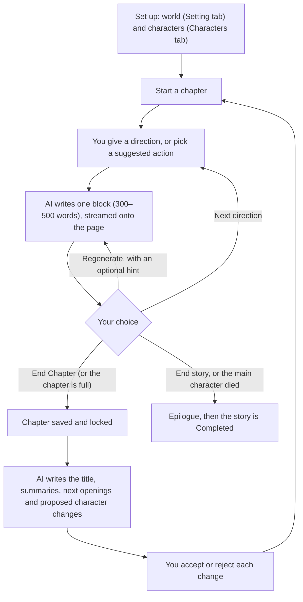
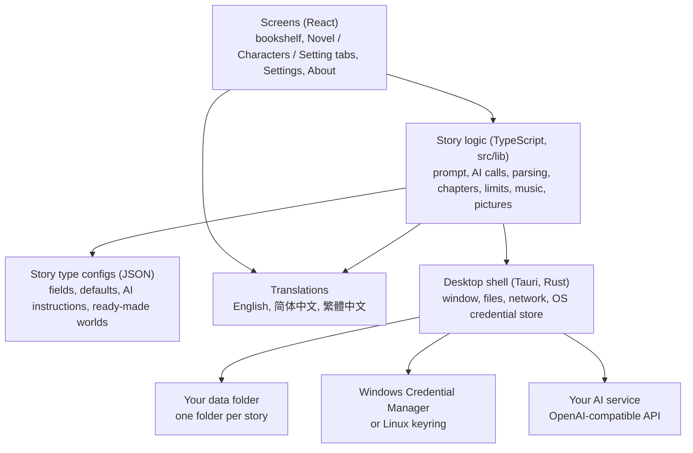

# Design overview

Last updated: 2026-11-01 (version 0.3.0, alpha)

How the AI Novel Generator works and how it is put together, in plain words. It is written for anyone who wants the big picture: testers, new contributors, or the author coming back after a break. It does not replace the detailed documents:

- what the app must do, rule by rule: [spec.md](spec.md)
- why each choice was made: [decisions.md](decisions.md)
- the code in detail, file by file: [tech/](tech/README.md)

## 1. The idea

The app is a writing partner for interactive novels. You build a world and its people, the AI writes the story a few paragraphs at a time, and you steer after each part. It runs on your own computer, keeps your stories as plain files, and talks only to the AI service you chose, with your own key.

Four ideas shape the whole design:

| Idea | What it means in practice |
| --- | --- |
| **You stay the author** | The AI proposes and you decide. It never changes your setting or characters without your OK, and chapter text is fixed once a chapter ends. |
| **Cost stays flat** | Each request sends short summaries of the past, never the whole book, so chapter 50 costs about the same as chapter 2. |
| **Your data is yours** | Everything is readable markdown and JSON in one folder per story. You can open, back up or copy it without the app. |
| **Genres are data, not code** | A story type (cultivation, romance, fantasy, general) is a config file: its fields, defaults and instructions for the AI. A new genre is a new file. |

## 2. How a story is written



**Blocks.** A chapter is a series of blocks. After each block the AI offers two or three next actions, each with a short note on what it might lead to. Only the latest block can be regenerated; earlier versions are kept until you move on, so you can switch back.

**Chapter length.** Each story has a chapter length (Short, Medium, Long). A progress bar fills as words are written. At the target the AI is told to steer toward an ending; at 150% the next block closes the chapter.

**End Chapter.** One AI call reads the finished chapter and returns a title, a summary of the chapter, an updated "story so far", the kinds of scenes already used (so they are not repeated), openings for the next chapter and proposed changes to characters (a new skill, a changed relationship, a new character). Nothing is written to a character until you accept it.

**Ending.** A story ends with an epilogue, either because you chose End story or because the main character died and you accepted it. A setting decides whether the AI may kill the main character at all.

**Story length.** A Short story (about 8 chapters) or Long story (about 60, in three volumes) tells the AI where it is in the arc; Continuous has no planned end. It only guides pacing; it never ends a story by itself.

## 3. What the AI is sent

The heart of the design is the prompt: what the AI sees each time it writes a block. It is built from layers, each with a size cap, in this order:

| # | Layer | Why it is there |
| --- | --- | --- |
| 1 | Writing instructions and the story type's rules | Language, tone, point of view, content rating, the answer format |
| 2 | The setting | The world |
| 3 | Your pinned notes | Facts you want the AI never to forget |
| 4 | Characters in the scene | The main character, plus anyone named in this chapter, your direction or the last summary |
| 5 | The story so far | A capped summary of everything before |
| 6 | Scenes already used | So the AI does not write the same kind of scene again |
| 7 | Recent chapter summaries | The last 1, 3 or 5 chapters, by budget |
| 8 | The end of the previous chapter | So the new chapter picks up smoothly |
| 9 | This chapter's blocks so far | In full |
| 10 | Your direction | What happens next |

Layers that rarely change come first, so providers that cache prompts can charge less for them. Settings has a **Context budget** (Lean, Balanced, Rich) that sets how big each layer may be. Characters are picked by a plain name match, without an extra AI call.

**The answer format.** The AI answers in a fixed shape: the story text, a `=== NEXT ===` line, the suggested actions with their notes, then a few machine-read lines (did the main character die, the mood for music, and on Rich pictures a scene description). The app shows only the story text and the actions; the other lines are read and hidden. The app is forgiving about small format mistakes, because real providers make them.

**Languages.** The novel's language is separate from the app's screen language. For Chinese novels the prompt carries extra notes so the prose reads as native writing, not a translation.

## 4. Music and pictures

Both are optional extras that never get in the way of writing.

**Music.** The AI tags each block with a mood: tense, battle, reveal, sad, triumphant, romantic, or (most of the time) none. A block with a mood fades in that mood's track, which plays once and fades out. A new peak crossfades into its own track; ending a chapter fades the music out. The six tracks ship with the app (Kevin MacLeod, CC BY 4.0).

**Pictures.** Off by default, because each one costs money. **Lite** makes one picture per chapter at End Chapter; **Rich** makes one per block. The text AI already describes the scene in its answer, so no extra text call is needed; the app adds the story type's art style and the characters' appearance and asks an image service (the OpenAI images API format, with its own key) for a picture. A picture is drawn in the background: writing never waits for it, and a refused or failed picture only shows a message with Try again.

## 5. How the app is built



| Part | Built with | Its job |
| --- | --- | --- |
| Desktop shell | Tauri 2 (Rust) | Opens the window, gives the app access to its data folder and the network, keeps the API keys in the system's password store, makes the installer |
| Screens | React and TypeScript | What you see and click. Screens decide what to show, not what is allowed |
| Story logic | TypeScript, no UI code | Every rule of the spec: building prompts, calling the AI, reading its answers, saving files, chapter limits, End Chapter, locking the setting |
| Story type configs | JSON files | The fields and AI instructions of each genre, and curated worlds and characters in three languages |
| Translations | TypeScript files | Every text you read, in three languages |

Rules that keep it simple:

- **Files are the truth.** After every change the screens reload what they show from the files, so what you see always matches what is saved. A crash or a closed window loses at most the block being written.
- **One door to the AI.** All AI calls go through one module. Supporting another kind of API would change that one place.
- **One door to the system.** Only four small modules know whether they are running in the real app or in a browser. That is what lets the same code run in the desktop app, in the browser preview and in the automated tests.
- **The Rust side stays small.** It only registers the standard Tauri plugins and the commands that save, read and delete the API keys.

## 6. Where your data lives

```
<data folder>/
  app-settings.json          your settings (never the API key)
  stories/
    <story>/
      story.json             title, type, language, status
      setting.md             the world
      notes.md               your pinned notes
      summary.md             the story so far
      scenes.md              kinds of scenes already used
      characters/*.md        one file per character
      chapters/001/          chapter.md, its summary, the review, a snapshot, pictures
      draft/                 the chapter in progress
```

- **Windows:** `%APPDATA%\ainovelgenerator`. **Linux:** `~/.local/share/ainovelgenerator`. Settings → Open data folder takes you there.
- Builds before 2026-11-01 named the folder `com.jckek.ainovelgenerator`. The first start of a newer build moves your settings and stories into the new folder by itself (decision 154).
- Setting and character files are markdown with a short header for the form fields, so they read well in any text editor and go into the prompt as they are.
- Each finished chapter keeps a snapshot of the setting and characters as they were, for a future "rewind" feature.
- Uninstalling the app leaves this folder in place.

## 7. Security and privacy

- **API keys** are kept in the system's password store, never in a file or a log.
- **Nothing is sent** anywhere except to the AI and image services you configured. There is no account, no analytics and no update check inside the app.
- **AI answers are shown as plain text**, never as HTML, so an answer cannot run code in the app.
- The built app has a strict Content Security Policy. The app window may read and write only its own data folder, and open only that folder in the file explorer (decisions 150, 151, 154).
- The latest security review is in [security/2026-11-01-all.md](security/2026-11-01-all.md).

## 8. How it is tested

| Layer | What runs | What it proves |
| --- | --- | --- |
| Type check | TypeScript compiler | The code fits together |
| Unit tests | Vitest | The story rules in `src/lib`: prompts, parsing, limits, End Chapter, files |
| Config tests | Vitest | Every story type and curated world is complete in all three languages |
| End-to-end tests | Playwright in Microsoft Edge | Real user flows in the browser preview |
| Hands-on checks | People and the QA agent | The acceptance checks of each phase, in the real app |

No automated test calls a real AI. A **mock AI server** (`npm run mock-ai`) answers like a real provider; each test key makes it behave differently (normal blocks, slow streams, dropped connections, rate limits, a character death, refused pictures), so every error path can be tried for free. How to run all of this is in the [README](../README.md#run-the-tests); the full plan is in [testing.md](testing.md).

## 9. How the project is run

The docs lead the code: a change of behaviour is written into the spec first, every choice gets one row in the decision log, and the work is cut into phases, each with a checklist of acceptance checks ([phases/](phases/)). A phase is Done only when every check has passed in the real app. Where things stand now is in [progress.md](progress.md).

| Version | Phase | What it brought |
| --- | --- | --- |
| v0.1 | 1–5c | Stories, setting and characters, the writing loop, chapters and endings, Windows installer, Linux packages |
| v0.2 | 6 | Three UI languages, curated worlds with Randomize, token counts, visible progress |
| v0.3 | 7, 7b | New look (bookshelf, art, animation), Fantasy and General story types |
| Alpha | 8 | Music and pictures |
| Next | | Alpha test with real users, fixes, then v1 |

## 10. Going deeper

| To understand… | Read |
| --- | --- |
| Every rule and number | [spec.md](spec.md) |
| Why it was done this way | [decisions.md](decisions.md) |
| The code's layers and rules | [tech/architecture.md](tech/architecture.md) |
| What each source file does | [tech/modules.md](tech/modules.md) |
| A block from click to saved file | [tech/ai-pipeline.md](tech/ai-pipeline.md) |
| The file formats | [tech/data-and-storage.md](tech/data-and-storage.md) |
| Story type config files | [tech/story-types.md](tech/story-types.md) |
| Music and pictures | [tech/music-and-pictures.md](tech/music-and-pictures.md) |
| Desktop app versus browser preview | [tech/platform.md](tech/platform.md) |

The technical pages were last checked against the code on 2026-11-01.
