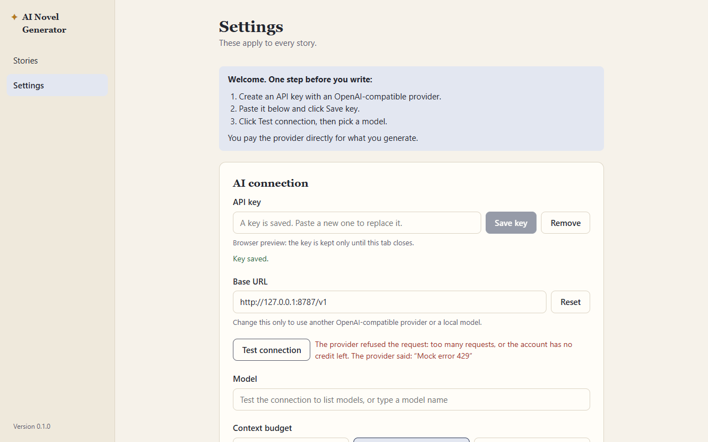
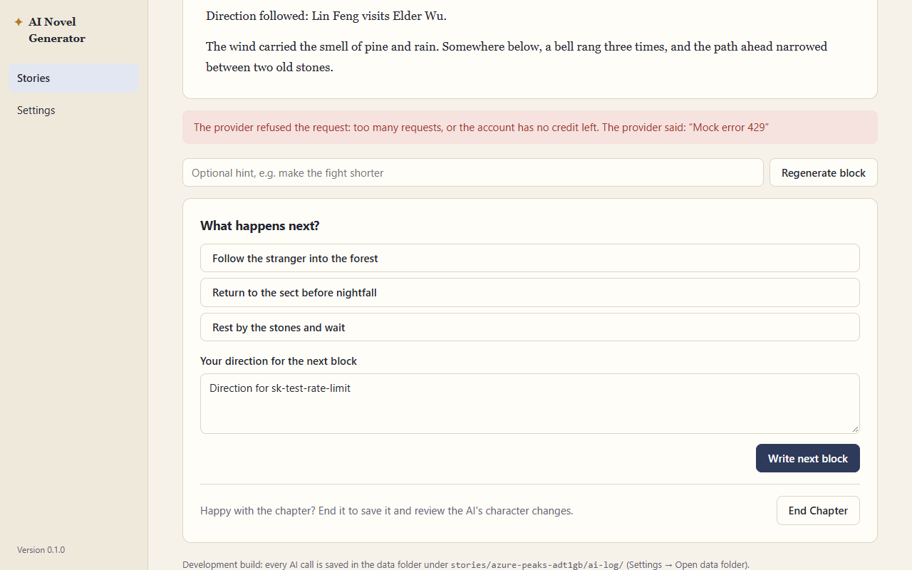
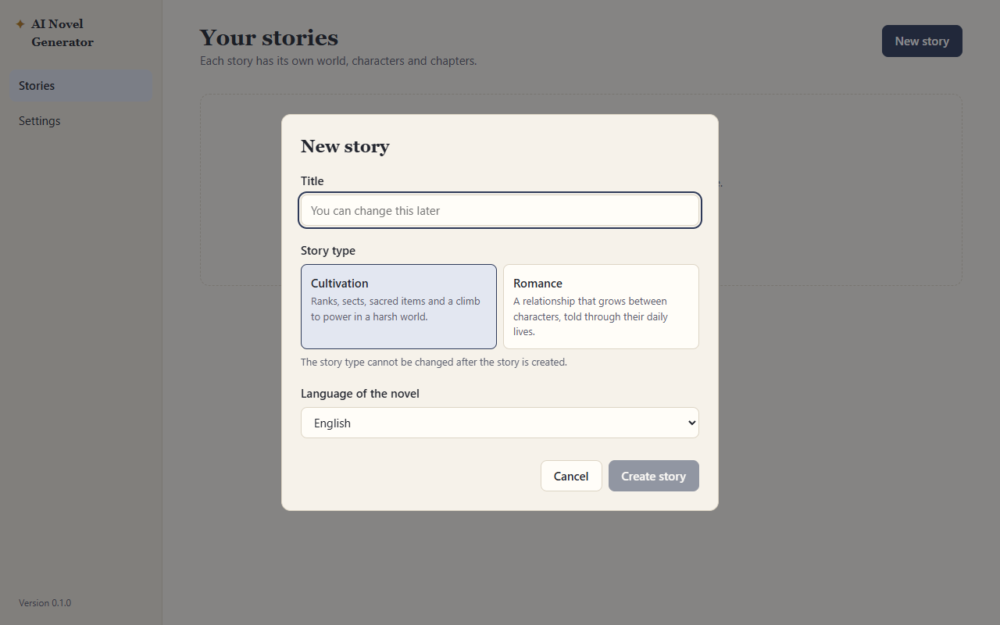
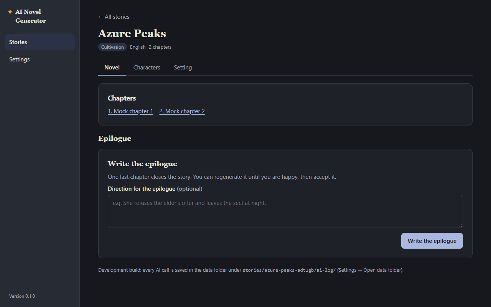
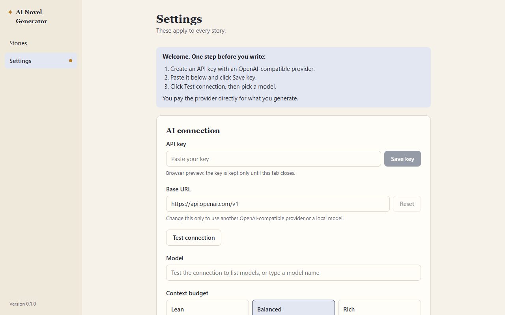
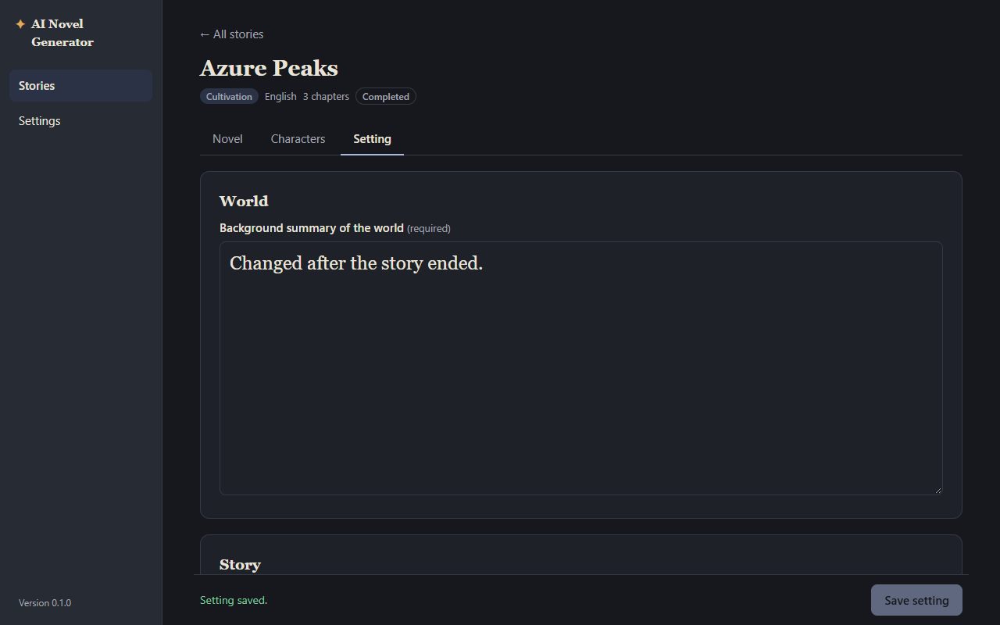
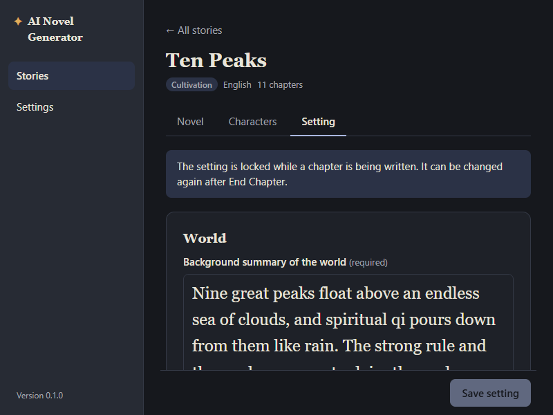

# QA: phase 5 (polish) and the full user journey

**Date:** 2026-10-12 · **Tester:** qa-tester agent · **Build:** browser preview (npm run dev), mock AI
**Scope:** phase 5 acceptance checks, spec 6.2 and 9, plus a full newcomer-to-ending journey with extra depth on error messages, unsaved work and empty/loading states · **Time spent:** about 2 hours

## Summary

The budget levels and flat request size work as the spec's tables say: Lean < Balanced < Rich with the right number of summaries, tail and character detail, and chapter 10's request is 1.02× chapter 2's. Error messages are good on the whole: plain, with the provider's own words after ours, and a failed block never touched the draft. The main gaps are around the edges of those messages: the 429 message has no next step, and following the messages' own advice ("check … in Settings") throws away the direction the user just typed. Focus does not stay inside dialogs, the story title cannot be changed although the New story dialog says it can, and nothing warns before closing the window with unsaved Setting edits. The installer checks (4, 5), real AI consistency over ten chapters, and loading states (instant in the preview) need the real app and a person.

| Pass | Fail | Partial | Preview only | Not testable here |
| --- | --- | --- | --- | --- |
| 1 | 0 | 2 | 0 | 2 |

## Acceptance checks

| Phase · AC | Check (short) | Spec | Result | Evidence / note |
| --- | --- | --- | --- | --- |
| 5 · 1 | Budget Lean → Rich changes request size as the table says | 6.2 | Pass | Ten Peaks, chapter 11, same block regenerated under each budget (`sk-test-stream-long~bud`, `_last-request`): total 5,722 / 8,047 / 9,934 chars. Recent summaries 1 / 3 / 5 (139 / 351 / 563 chars); previous-chapter tail none / 1,695 / 3,362 chars (about 300 / 600 words); character section 1,271 (header only) / 1,671 / 1,671. Rich adds a character from the last 3 chapters: chapter 12, Elder Wu named only in chapter 11 → Balanced sends Lin Feng only, Rich sends Lin Feng + Elder Wu. Token ranges in the table (3,000–6,000 etc.) need real layer sizes; check with `ai-log/` in the real app |
| 5 · 2 | Ten-chapter story stays consistent; chapter 10 request ≈ chapter 2 | 6.1, 6.2 | Partial | Size part passes: second block of each chapter, Balanced, Short chapters: ch 1 10,594 → ch 2 12,513 → ch 4 12,730 → ch 10 12,732 chars (1.02× chapter 2), flat from chapter 4 once 3 summaries exist. Each chapter took about 3 s end to end at chapter 10, same as chapter 2. "Stays consistent" needs real AI output; the mock writes fixed text |
| 5 · 3 | Every error names what went wrong and what to do next | 9, decision 56 | Partial | Wrong key, 403, 500, not JSON, dropped stream, network off, no key, no model, 404 (model-name hint), End Chapter failure all name the problem and a next step, keep the draft and keep the typed direction. The 429 message names no next step ([QA-01](#qa-01--major--errors--the-429-message-has-no-next-step)). Not testable here: a real 400 for a wrong model name, file errors (disk full, permissions) |
| 5 · 4 | Installer installs on a clean machine; starts from Start menu | 3 | Not testable here | Needs a second Windows PC: run `AI Novel Generator_0.1.0_x64-setup.exe`, confirm no administrator prompt, start from the Start menu, write a block |
| 5 · 5 | Uninstall removes the app, leaves the data folder | 3, decision 55 | Not testable here | After uninstall from Settings → Apps, `%APPDATA%\com.jckek.ainovelgenerator` must still exist; also confirm the uninstaller's "delete app data" box is unticked by default |

Spec 9 rules outside the AC list, also checked:

| Rule | Result | Note |
| --- | --- | --- |
| First launch opens Settings with a guide to getting a key | Partial | Opens on Settings with a 3-step guide; it does not say where to get a key ([QA-08](#qa-08--minor--first-launch--the-guide-does-not-say-where-to-get-a-key-or-what-comes-after-the-model)) |
| Test connection reports success or the error in plain words | Pass | All mock failures, dead port, wrong path and "not a url" give a clear message |
| Leaving a story with unsaved Setting edits asks first | Partial | Asks from "← All stories" and the side rail; Escape keeps editing ([shot](shots/2026-10-12-phase-5/04-unsaved-setting-dialog.png)). No warning on closing or reloading the window, and unsaved pinned notes are dropped silently ([QA-04](#qa-04--minor--unsaved-edits--closing-the-window-or-leaving-with-unsaved-pinned-notes-loses-them-silently)) |
| A failed block never loses the draft | Pass | Block count unchanged after every error key; reload after a failed End Chapter shows "summary pending" and the retry works ([shot](shots/2026-10-12-phase-5/05-end-chapter-failed.png)) |
| Empty states | Pass | Story list ("No stories yet" + New story), Characters ("No characters yet. Start with the main character."), Novel before set-up (checklist with "Go to Setting / Go to Characters"), completed story ("The story is complete") |
| Loading states (story list, chapter reader, End Chapter) | Preview only | "Saving the chapter and writing its summary…" shows during End Chapter. The list and reader load instantly from localStorage, so their loading states could not be seen; check them in the real app with a large data folder |

## Findings

### QA-01 · Major · Errors · The 429 message has no next step

**Status:** Fixed 2026-10-12 (decision 58). A 429 now says to wait a minute and try again; no credit (402, or 429 with `insufficient_quota`) says to add credit. New mock key `sk-test-no-credit`; E2E-21 covers both.

**Steps** (key `sk-test-rate-limit`, base URL `http://127.0.0.1:8787/v1`):
1. Settings → paste the key → Save key → Test connection. Or: in a story with one block, write the next block.

**Expected:** a plain message with the next step; spec 9 lists "no credit" and "rate limit" as separate cases, each with a next step (e.g. "Wait a minute and try again. If it keeps happening, check your credit with the provider.").
**Actual:** "The provider refused the request: too many requests, or the account has no credit left. The provider said: “Mock error 429”". It says what may be wrong but not what to do, and it leaves the user to guess between two very different causes. The phase 5 AC "every error … what to do next" fails for this one message.
**Evidence:**  
**Likely cause:** `src/lib/ai.ts:72`. The unit test `src/lib/ai.test.ts:24` pins the current wording, so it will need updating too.

### QA-02 · Minor · Novel page · A typed direction is lost when the user leaves the story, including when an error message sends them to Settings

**Status:** Fixed 2026-10-12 (decision 59). The unsent direction and regenerate hint are kept per story while the app runs; leaving mid-block asks first ("Stay" / "Leave and discard the block"). Covered by U-US and E2E-23.

**Steps** (key `sk-test-server-error`, story at the epilogue or any "Write next block" step):
1. Type a direction, click Write (epilogue / next block). The 500 message shows; the direction is still there (good).
2. Do what the message family suggests for other errors: go to Settings, fix the key, come back to the story.

**Expected:** the user's typed direction is still there (spec 9: errors say what to do next; following that advice should not cost work).
**Actual:** the direction box is empty. Same after "← All stories" and back, and after leaving the story while a block is streaming (the stream is cancelled with no notice and the direction is gone). Switching between the story's own tabs keeps it. Seen 3 times (epilogue, chapter 3 start, mid-stream leave).
**Evidence:** step logs: "direction after visiting settings: \"\"", "direction after leaving story: \"\"".
**Likely cause:** the direction is component state of the Novel page, which unmounts when the story closes.

### QA-03 · Minor · Accessibility · Dialogs do not keep keyboard focus inside them

**Steps** (any profile with a story):
1. Stories → New story. Press Tab repeatedly.
2. In a story between chapters, click End story. Press Tab.

**Expected:** Tab cycles inside the dialog; the page behind cannot be reached until the dialog closes; focus moves into a dialog when it opens.
**Actual:** in New story, Tab goes Title → type → language → Cancel → page body → "Stories" and "Settings" in the side rail → story cards behind the modal. In "End the story?", focus stays on the page's End story button when the dialog opens. After Escape on New story, focus lands on "Delete Azure Peaks" instead of the New story button. The same likely applies to every dialog (delete, discard changes, End Chapter, accept epilogue). Reproduced twice.
**Evidence:** step log "NEW STORY DIALOG TAB ORDER" and "END STORY TAB" (test-results/qa, step 29).

### QA-04 · Minor · Unsaved edits · Closing the window or leaving with unsaved pinned notes loses them silently

**Steps** (key `sk-test-valid`, story between chapters):
1. Setting tab → change the world background → reload the page (in the app: close the window).
2. Setting tab → type in Pinned story notes only, don't click Save notes → "← All stories".

**Expected:** spec 9 "Leaving a story with unsaved Setting edits asks first". Closing the app is the most common way to leave. Pinned notes are edited on the same tab, and the dialog speaks of "the changes on the Setting tab".
**Actual:** 1: no prompt; the edit is gone (no `beforeunload` or Tauri close handler in `src/`). 2: no prompt; the notes are gone.
**Evidence:** step log 12: "NOTES-ONLY leave -> dialog: 0", "RELOAD beforeunload dialog: false". Case 1 should be confirmed in the real app by closing the window.

### QA-05 · Minor · Story list · The story title cannot be changed, but the New story dialog says it can

**Steps:** Stories → New story. Read the Title placeholder. Create the story, then look for a way to rename it.

**Expected:** "You can change this later" should be true, or the hint should not be there.
**Actual:** there is no rename anywhere (story header, Setting tab, story list). Only chapter titles can be renamed (`renameChapter`).
**Evidence:**  · placeholder in `src/pages/StoryList.tsx`.

### QA-06 · Minor · Ending · After confirming End story there is no way back to writing chapters

**Steps** (key `sk-test-valid`, a story between chapters):
1. Novel → End story → End story in the dialog.
2. Look for a way back before writing the epilogue; reload.

**Expected:** a user who changes their mind before the epilogue is written can go back (nothing has been written yet). The spec does not say either way; the dialog says "The next step is the epilogue".
**Actual:** the page shows only "Write the epilogue", and stays so after a reload. The story can only be completed or deleted. The epilogue direction box also shows the chapter placeholder "She refuses the elder's offer and leaves the sect at night", which does not fit an epilogue.
**Evidence:** 

### QA-07 · Minor · Settings · An invalid base URL is saved and stays after a restart

**Steps:** Settings → Base URL → type `not a url` → click elsewhere → Test connection ("The base URL must start with http:// or https://.") → reload.

**Expected:** an invalid URL is not saved, or the field shows the error when it is saved, not only on Test connection.
**Actual:** the field still says `not a url` after the reload; every block will fail until the user notices. Reset fixes it.
**Evidence:** step log 04: "BASE URL after reload: not a url".

### QA-08 · Minor · First launch · The guide does not say where to get a key or what comes after the model

**Steps:** fresh profile, open the app.

**Expected:** spec 9 "a short guide to getting an API key". A newcomer should reach their first block with only the on-screen guide.
**Actual:** step 1 is "Create an API key with an OpenAI-compatible provider." There is no name or link of any provider and no mention of where the key page is usually found, which is the step a newcomer is most likely to get stuck on. After step 3 ("pick a model") nothing points to Stories → New story; the user has to find the side rail. Once the key is saved the guide disappears on the next start. Still needs the planned review with a real new user (phase 5 task).
**Evidence:** 

### QA-09 · Polish · Completed story · Setting and Characters still read as if more will be written

**Steps:** complete a story (End story → epilogue → Accept). Open the Setting and Characters tabs.

**Expected:** the tabs make clear that the story is finished.
**Actual:** the setting can be edited and saved ("Setting saved."), and Characters says "Edits apply from the next block written." with "Add character", though no block can be written again. No harm done, but confusing.
**Evidence:** 

### QA-10 · Polish · Wording · Small inconsistencies in messages

- Setting tab during the End Chapter review: "The setting is locked while a chapter is being written. It can be changed again after End Chapter." The user has already clicked End Chapter; "after you finish the review" would be accurate.
- Delete dialog for a story with no chapters: "…with its setting, characters and all 0 chapters."
- End Chapter failure: "The provider stopped with an error: Mock End Chapter failure. Try again." puts the provider's words first; every other message uses "ours, then The provider said: “…”" (decision 56).
- Test connection with a key that has no models: "Connected. 0 models are available." gives no next step (type the model name by hand).
- Errors on the Novel page say "Check that it is copied in full" (wrong key) without saying it is in Settings; "Settings" in the other messages is plain text, not a link.

### QA-11 · Polish · Appearance · The reading font size also enlarges the world background box on the Setting tab

**Steps:** Settings → font size 24 → open a story's Setting tab at 800×600.

**Expected:** spec 9: font size "applies to the reading view".
**Actual:** the background textarea uses the reading font (large serif) while every other field keeps the UI font. It may be intended (it is prose), but at 24 px only about 3 lines fit in a small window.
**Evidence:** 

## Suggestions

| # | Suggestion | Helps | Why | Size | Spec change? |
| --- | --- | --- | --- | --- | --- |
| S-01 | Show which story is which when titles repeat (last edited date on the card), or warn on a duplicate title | Users with many stories | Two "Ten Peaks" cards look identical ([shot](shots/2026-10-12-phase-5/09-duplicate-titles.png)) | Small | No |
| S-02 | Reopen the last story and tab after a restart | Returning users | A reload always lands on the story list | Small | No (decision 25 keeps the view in state; it can still be saved) |
| S-03 | Cap or warn on very long directions | Cost-aware users | A 5,500-character direction was accepted and sent in full; it is the one uncapped layer in spec 6.1 | Small | Yes (6.1/6.2) |
| S-04 | Ask before "Remove" key in Settings | Everyone | One click deletes the key from the credential store with no confirmation | Small | No |
| S-05 | Warn before leaving a story while a block is being written | Impatient users | The stream is cancelled silently and the user pays for a block they never see | Small | No |
| S-06 | Chapter list as a collapsible list or drop-down once it has more than about 10 entries | Long stories | At chapter 12 the link row already wraps to two lines; a 60-chapter Long story would be a wall of links ([shot](shots/2026-10-12-phase-5/12-chapter-12-dark.png)) | Medium | No |
| S-07 | Arrow-key support on the Novel / Characters / Setting tabs (ARIA tab pattern) | Keyboard users | Tab works, but ArrowRight does nothing on a `role=tab` | Small | No |
| S-08 | A link in the 404 / no-model / no-key messages that opens Settings | Newcomers | The message names Settings; one click saves a hunt | Small | No |

## E2E gaps

- E2E: `sk-test-rate-limit` on the Novel page and in Test connection shows a next step (wait / check credit) (QA-01)
- E2E: type a direction, get an error, open Settings and come back: the direction is still there (QA-02)
- E2E: Tab in each dialog (New story, Delete, Discard changes, End Chapter, End story, Accept epilogue) stays inside it; Escape returns focus to the opener (QA-03)
- E2E: unsaved pinned notes → "← All stories" asks first (QA-04)
- E2E: budget switch on the same block gives Lean < Balanced < Rich in `_last-request`, and Rich adds a character named only in a recent chapter (AC 1 in the UI, beyond the unit-level request-size test)
- E2E: an invalid base URL is not kept after a reload (QA-07)

## Exploration log

- **Newcomer.** Fresh profile → Settings with guide. Test connection with no key: "Enter an API key first." Testing with a typed but unsaved key uses that key (good). Wrong key, 403, 429, 500, not JSON, no models, dead port, wrong path (`/v2`, "Nothing was found at this base URL… most end in /v1") and "not a url" all gave clear messages; only 429 lacks a next step. The model field is a datalist that fills after Test connection. Story list empty state, New story dialog (Create is disabled for a blank or spaces-only title), story opens on the Novel checklist with "Go to Setting" / "Go to Characters". Setting saves with defaults; the main character saves with the example. First block reached without help beyond the guide, once the key and model were set.
- **Writer.** Ten Peaks: Short chapters, Short story, `sk-test-stream-long`, two blocks per chapter, End Chapter, review, 12 chapters in all. Each chapter took about 3 s with no slowdown; the request size was flat from chapter 4. The chapter list, the reader ("← Back to the current chapter", "Chapter 3 · read-only") and the Rich/Balanced budgets all behaved. Reviews: approve, reject, "Edit first" opens a pre-filled form for Elder Wu, Finish stays disabled until all are answered. A review left open survives a reload, with the setting locked.
- **Impatient.** Double-clicking "Start chapter 1" wrote one block, not two. Switching tabs mid-stream keeps the stream. Stop → "Stopped. The unfinished block was discarded; the chapter is as it was." and the direction is kept; Start again at once works. Leaving the story mid-stream cancels silently (S-05, QA-02). Closing the browser mid-stream left the chapter at 0 blocks with nothing broken.
- **Careless.** A title with `#`, `*`, `===`, emoji, Chinese and quotes shows correctly everywhere. Duplicate titles are allowed (S-01). Markdown characters in a direction pass through untouched. A romance character aged 17: "Characters in this story type must be 18 or older." A Chinese story counts characters ("5,702 of 4,000 characters · target reached"). A spaces-only world background is refused with "Describe the world in a few sentences."
- **Unlucky.** Every error key on the Novel page: the block count is unchanged and the direction is kept. End Chapter failure → "summary pending", survives a reload, retry opens the review. An error during the epilogue keeps the epilogue step.
- **Keyboard.** Visible focus ring everywhere checked. Tab order on the story page is logical. Dialogs close with Escape; focus is not trapped (QA-03).
- **Themes and sizes.** Dark theme on Settings, story list, Novel, reader, Setting, Characters and the delete dialog at 1280×800 and 800×600: no overflow or cut-off text, good contrast. Font size 24 applies to the reading view (and the world background box, QA-11).
- **Console.** No errors other than the known `favicon.ico` 404. Every streamed request shows as `net::ERR_ABORTED` in the network log; it comes from `reader.cancel()` after `[DONE]` (`src/lib/ai.ts:254`). It is harmless, and only worth knowing so nobody chases it.

## Not covered

- **Installer and uninstall (AC 4, 5):** needs a second Windows PC; see the phase file's "How to check".
- **Real AI:** consistency over ten chapters, tone over a full chapter (Known gap), a real 400 for a wrong model name, the token ranges in the spec 6.2 table. Use a real key in the real app and compare `ai-log/` files.
- **File errors** (disk full, a read-only data folder, a hand-broken `setting.md`): the browser preview stores in localStorage, so the "plain words for file errors" work could not be triggered.
- **Loading states** of the story list and chapter reader: instant in the preview.
- **Window close with unsaved edits** in the real Tauri window (QA-04 case 1 was seen only as a browser reload).
- **First-launch review with a real new user** (phase 5 task): QA-08 is a tester's guess, not a substitute.
- Not re-tested in depth: the died-flag pause and malformed-block keys (phase 4, covered by E2E-13 and E2E-19).
