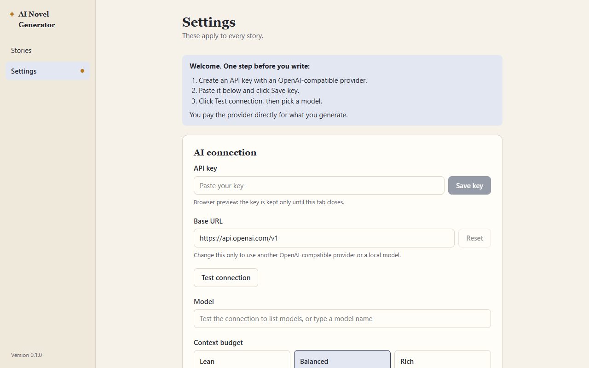
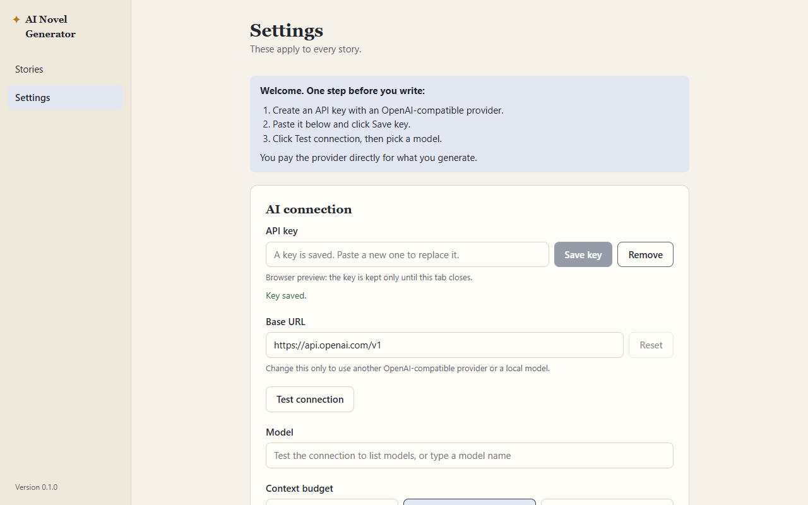
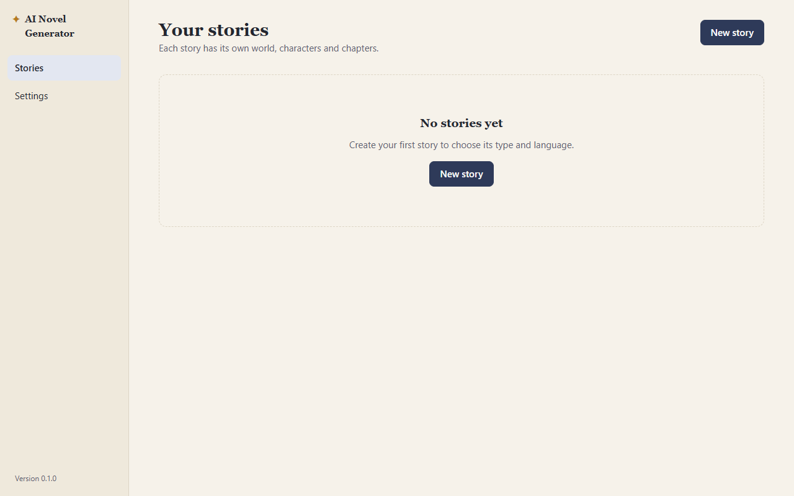
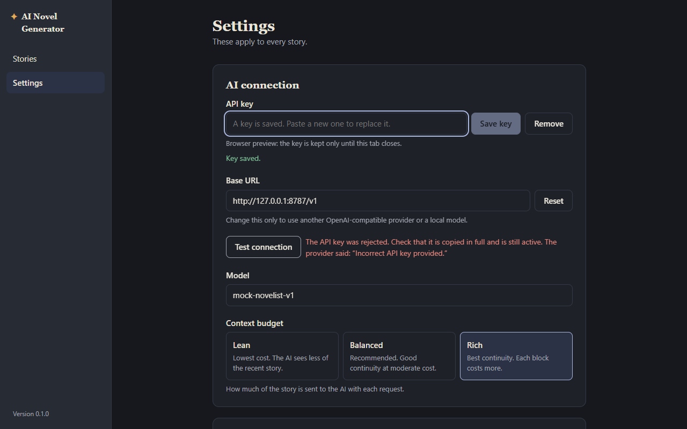
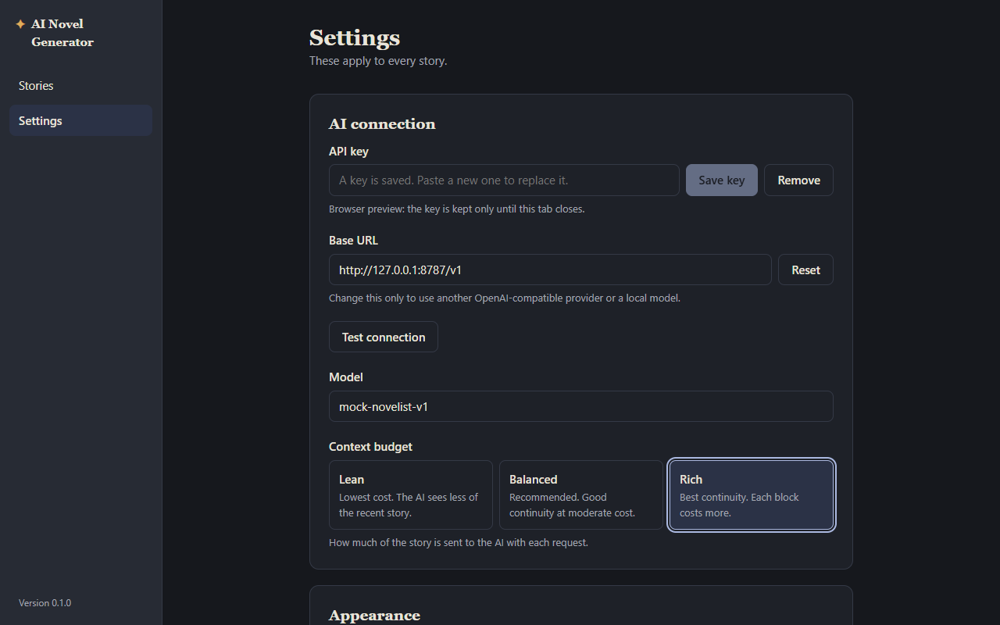
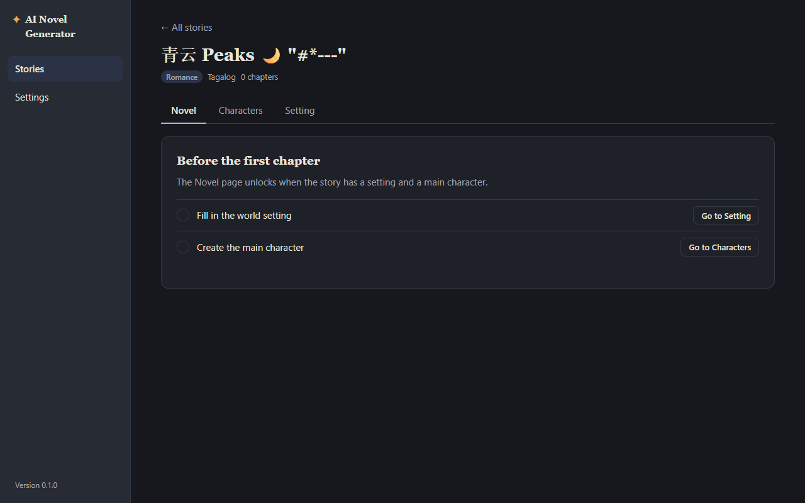
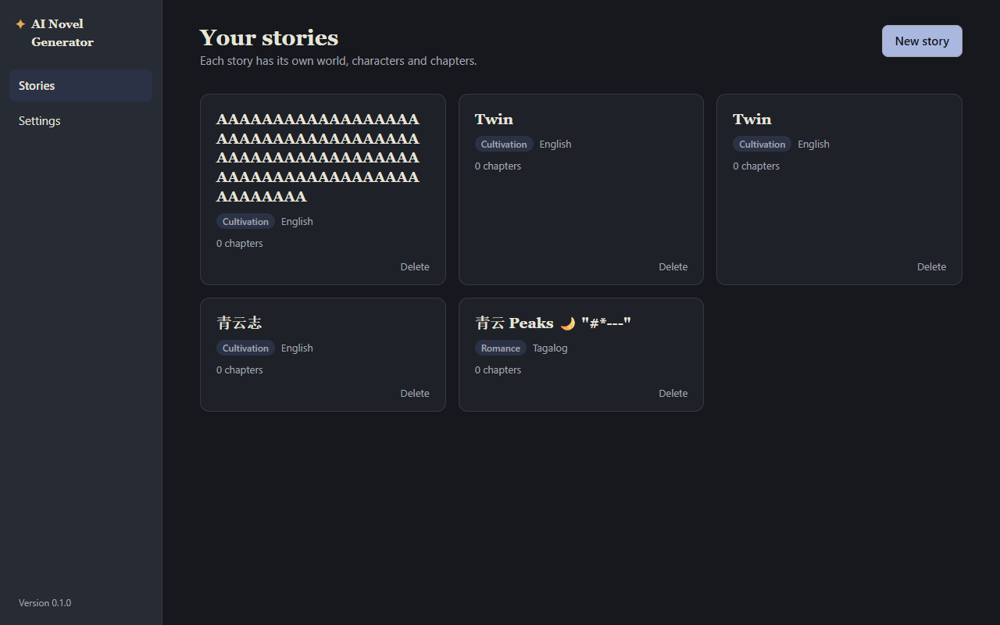
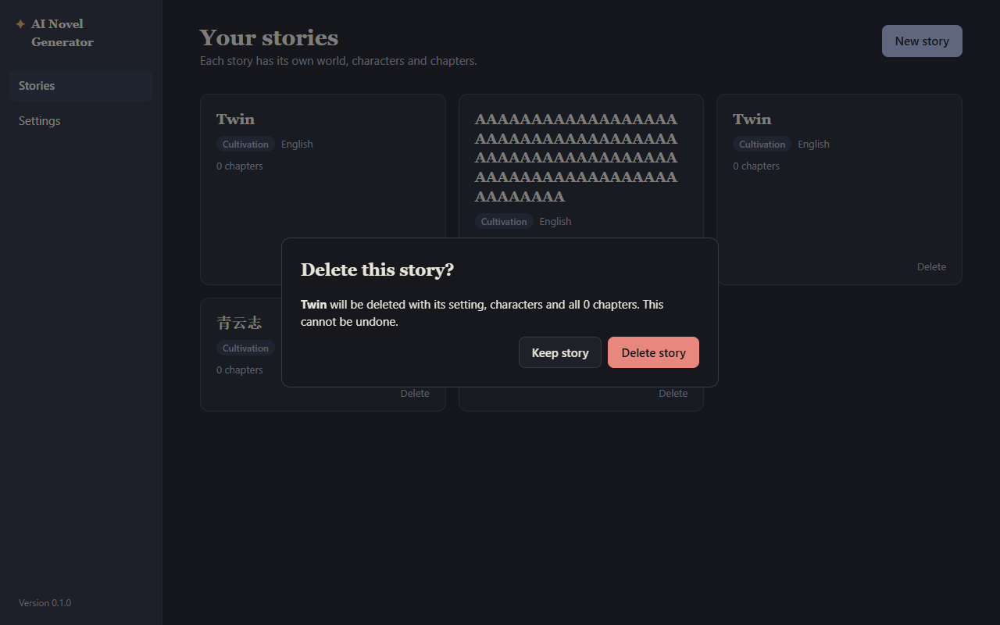
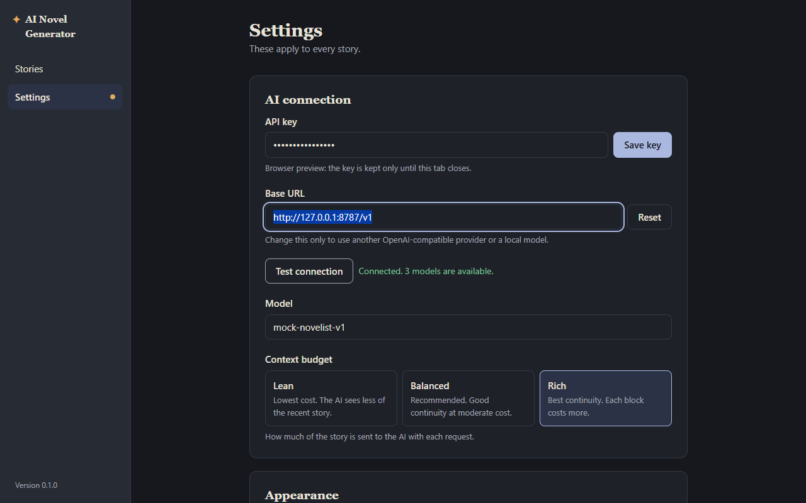

# QA: Phase 1 (Skeleton), re-verification

**Date:** 2026-10-13 · **Tester:** qa-tester agent · **Build:** browser preview (npm run dev), mock AI
**Scope:** Phase 1 acceptance checks 1–10 · spec §2, §3, §4 (create rules), §9 · decisions 3, 25, 26, 46, 56, 58 · **Time spent:** about 1 hour

## Summary

Every part of the phase 1 checks that the browser preview can reach still works: the first-launch guide, "Key saved", the model count and list, the wrong-key message, font size / theme / budget applying at once and surviving a relaunch, creating, listing and deleting stories (including all of a deleted story's files in browser storage). No acceptance check failed. Seven of the ten checks are about the Credential Manager, files on disk, the data folder or a real restart, so they are marked "Not testable here" with manual steps below; their preview half passed. The findings are all Minor or Polish and sit around the checks rather than in them: "Test connection" says "Connected" for a key that was typed but never saved (P1-01), the New story dialog promises the title "can be changed later" when there is no way to rename (P1-02), and the model list keeps models from an earlier, different connection (P1-03).

| Pass | Fail | Partial | Preview only | Not testable here |
| --- | --- | --- | --- | --- |
| 3 | 0 | 0 | 0 | 7 |

## Acceptance checks

| Phase · AC | Check (short) | Spec | Result | Evidence / note |
| --- | --- | --- | --- | --- |
| 1 · 1 | First launch opens Settings with the guide | 9 | Pass | Fresh profile opens on Settings with "Welcome. One step before you write:" and three steps; rail shows "No API key saved".  |
| 1 · 2 | Saving a key shows "Key saved"; key in Credential Manager | 9, decision 3 | Not testable here | Preview half passes: "Key saved." shown, field cleared, placeholder "A key is saved…", leading/trailing spaces trimmed, Save disabled for spaces only, field is `type=password`.  Credential Manager: see Not covered. |
| 1 · 3 | After reopening, key still saved and guide gone | 9 | Not testable here | Preview: a relaunch with the key present opens on Stories, no guide, no "No API key saved" dot.  The preview keeps the key per tab by design, so key persistence needs the real app. |
| 1 · 4 | Valid key: model count, Model field lists them | 9 | Pass | `sk-test-valid~p1`: "Connected. 3 models are available."; `<datalist>` holds `mock-gpt-large`, `mock-gpt-small`, `mock-novelist-v1`. Singular "1 model is available" correct. Base URL with trailing `/` or surrounding spaces also works. Loading state "Testing…" with the button disabled (`sk-test-slow`). See P1-03 for a stale list. |
| 1 · 5 | Wrong key says it was rejected | 9, decision 56 | Pass | "The API key was rejected. Check that it is copied in full and is still active. The provider said: “Incorrect API key provided.”"  Also checked: 403, 429 rate limit, 429 no credit (decision 58), 500, not JSON, no server, no `/v1`, bad URL, no key: each names the problem and a next step. |
| 1 · 6 | Font size, theme, budget apply at once and survive restart | 9, 6.2 | Not testable here | Preview: slider (keyboard arrows) changes the reading view at once (Novel block text 20px → 14px without reload); Dark applies at once; budget change reaches the very next block in the same session (AI log `budget: rich` → `lean` → `rich`). All three survive a browser relaunch.  A real app restart is still to confirm. |
| 1 · 7 | Open data folder; `app-settings.json` without the key | 3, 9 | Not testable here | Preview: stored `app-settings.json` holds only `baseUrl`, `model`, `contextBudget`, `fontSize`, `theme`; no key in localStorage. The button does not exist in the preview (a note says so). |
| 1 · 8 | Creating a story opens it; `stories/<id>/story.json` on disk | 3, 4 | Not testable here | Preview: workspace opens on the Novel tab with the checklist; `stories/peaks-smhzml/story.json` holds id, title, type, language, status, chapterCount. Chinese, emoji, quotes and `#*---` in the title, "Other…" language (trimmed), Enter to submit, duplicate titles (distinct ids) all fine.  |
| 1 · 9 | Story list shows the story after restart | 3 | Not testable here | Preview: all five stories listed after each browser relaunch, newest first.  |
| 1 · 10 | Delete removes the card and its folder | 3 | Not testable here | Preview: confirmation "Delete this story?" with Keep story / Delete story; Keep and Escape keep it; Delete removes the card and all 7 stored files of that story (story.json, setting.md, character, draft.json, three ai-log files); the other "Twin" untouched.  See P1-06 for the wording. |

## Findings

### P1-01 · Minor · Settings · "Test connection" says "Connected" for a key that was typed but not saved

**Steps** (profile with stories, no saved key; base URL `http://127.0.0.1:8787/v1`):
1. Settings. Paste `sk-test-valid~p1` into API key. Do not click Save key.
2. Click Test connection.

**Expected:** The guide's order is Save key, then Test connection (spec §9 first-launch guide). A success message should not leave the user believing the app is set up when no key is saved, or the test should save the key, or say "Connected. Click Save key to keep this key."
**Actual:** "Connected. 3 models are available." The key field still holds the unsaved key and the rail still shows the "No API key saved" dot; no key is saved. A user who leaves now meets "no API key" on the Novel page.
**Evidence:** 
**Likely cause:** `src/pages/Settings.tsx` `test()` deliberately uses `keyInput` when present ("Tests with the key being typed…"); the success text does not mention that the key is not saved.

### P1-02 · Minor · Story list · New story title says "You can change this later", but a story cannot be renamed

**Steps** (any profile, key `sk-test-valid~p1`):
1. Stories → New story. Read the Title placeholder: "You can change this later".
2. Create the story. Look for a way to change its title on the card, in the workspace header, and on the Setting tab.

**Expected:** The hint matches the app. The spec has no story rename (§3 lists `title` in `story.json`, §4 describes creation only), so either the hint goes or a rename is added (spec change).
**Actual:** There is no rename anywhere. A user who types a working title on the strength of the hint is stuck with it (the only way out is to delete the story and start again).
**Evidence:** New story dialog snapshot (step 13): `textbox "Title": placeholder: You can change this later`; Setting tab has no title field.
**Likely cause:** `src/pages/StoryList.tsx:161`; `updateStory()` exists in `src/lib/stories.ts` but no page calls it for the title.

### P1-03 · Minor · Settings · The model list keeps models from an earlier connection after a later test fails

**Steps** (key `sk-test-valid~p1`, base URL `http://127.0.0.1:8787/v1`):
1. Settings → Test connection → "Connected. 3 models are available."
2. Paste `sk-wrong~p1`, Save key, Test connection → "The API key was rejected…".
3. Click into Model.

**Expected:** "Testing the connection lists the available models" (spec §9): after a failed test, the list should not offer models from a connection that no longer applies.
**Actual:** All three models are still offered. The same happens after changing the base URL to a dead port or after removing the key. A user who switches provider can pick a model the new provider does not have, and only finds out when writing a block.
**Evidence:** step 08/27 output: `datalist: ["mock-gpt-large","mock-gpt-small","mock-novelist-v1"]` after each failed test.
**Likely cause:** `src/pages/Settings.tsx` `test()` calls `setModels` only on success.

### P1-04 · Minor · Settings · An emptied Base URL is saved empty and stays empty after a restart

**Steps** (key `sk-test-valid~p1`):
1. Settings → clear Base URL → click elsewhere.
2. Relaunch the app (new browser launch). Open Settings.
3. Click Test connection.

**Expected:** Base URL "Defaults to OpenAI's" (spec §9); an empty value should fall back to the default (or not be saved).
**Actual:** `app-settings.json` stores `"baseUrl": ""`; after the relaunch the field is still empty and Test connection says "The base URL must start with http:// or https://." Writing blocks would fail the same way. The Reset button recovers it, so it is easy to work around once noticed.
**Evidence:** step 09 output: `saved after blank: { "baseUrl": "", … }`, `field after reload: ""`.

### P1-05 · Polish · Settings · Enter does nothing in the API key and Base URL fields

**Steps** (fresh profile):
1. Paste `sk-test-valid~p1` into API key and press Enter.
2. Type a new Base URL and press Enter.

**Expected:** Keyboard users can save with Enter (agent checklist: "Enter and Escape work"); the New story dialog already submits on Enter.
**Actual:** Enter in API key does not save the key (it is still unsaved, `sessionStorage` empty). Enter in Base URL does not save it either; only leaving the field does. In the real app, typing a URL and closing the window straight away would lose it.
**Evidence:** step 02 output: `stored: null` after Enter; step 24: saved base URL unchanged after Enter.

### P1-06 · Minor · Story list · Delete confirmation says "all 0 chapters" for a story with written blocks

**Steps** (key `sk-test-valid~p1`):
1. Create a story, save the default setting, create the main character, write three blocks of chapter 1.
2. Stories → Delete on that card.

**Expected:** A confirmation before anything destructive tells the user what they lose. Spec §3: the story folder holds the draft (`draft/draft.json`) as well as chapters.
**Actual:** "Twin will be deleted with its setting, characters and all 0 chapters. This cannot be undone." The chapter in progress (three blocks) is not mentioned, and "all 0 chapters" reads as if no writing is lost. With two stories of the same title the dialog also cannot tell them apart (see S-02).
**Evidence:** 
**Likely cause:** `src/pages/StoryList.tsx:245`.

### P1-07 · Polish · Settings · Old test result stays on screen after the key is removed or replaced

**Steps** (key `sk-test-valid~p1`):
1. Settings → paste `sk-wrong~p1`, Save key, Test connection → "The API key was rejected…".
2. Click Remove.

**Expected:** Messages describe the current state (spec §9: plain words with the next step).
**Actual:** "Key removed." shows under the key, while "The API key was rejected…" still shows next to Test connection, for a key that no longer exists. Saving a new key also leaves the old result in place until the next test.
**Evidence:** step 08 output, "after Remove" text.

### P1-08 · Polish · Settings · "Connected. 0 models are available." gives no next step

**Steps:** Save key `sk-test-no-models~p1`, base URL `http://127.0.0.1:8787/v1`, Test connection.

**Expected:** Spec §9: results in plain words with the next step. Some providers and local servers do not list models.
**Actual:** "Connected. 0 models are available." The Model placeholder does say "or type a model name", but the message itself reads like a dead end.
**Evidence:** step 07 output.

### P1-09 · Minor · Accessibility · Delete dialog does not take focus, and closing a dialog drops focus to the page

Not dialog focus trapping (QA-03); this is where focus starts and ends.

**Steps** (key `sk-test-valid~p1`, at least one story):
1. Stories → Tab to a card's Delete → Enter.
2. Note the focused element. Click Keep story (or press Escape).
3. Note the focused element. Repeat with New story → Cancel.

**Expected:** Focus moves into the dialog when it opens (the New story dialog does this, on Title) and returns to the button that opened it when it closes.
**Actual:** On open, focus stays on the card's Delete button behind the dialog, so Enter or Tab acts on the page, not the dialog. On close (Keep story, Escape, Cancel), focus goes to `<body>`: a keyboard user starts again from the top of the page.
**Evidence:** step 23 output: `focused on open: <button class="story-delete" aria-label="Delete Twin">`, `inDialog: false`; `after Keep: focused <body>`; step 28: `focus after Cancel: BODY`.

## Suggestions

| # | Suggestion | Helps | Why | Size | Spec change? |
| --- | --- | --- | --- | --- | --- |
| S-01 | Make the guide's first step concrete: a link or one line on where to get a key (e.g. "OpenAI: platform.openai.com → API keys"), and that a local model needs no key. | New users | Spec §9 asks for "a short guide to getting an API key"; the current step only says "Create an API key with an OpenAI-compatible provider". | Small | No |
| S-02 | Show the created or last-written date on story cards and in the delete dialog. | Users with similar titles | Two "Twin" cards are identical; deleting the right one is guesswork. | Small | No |
| S-03 | Add story rename (title only) if the hint in P1-02 is kept. | All writers | Working titles change. `updateStory()` already exists. | Small | Yes |
| S-04 | Ask before Remove key, or offer Undo. | Real-app users | In the real app Remove deletes the key from Credential Manager; a mis-click means finding and pasting the key again. | Small | No |

## E2E gaps

- E2E-02 extension: after a successful test, a failed test (wrong key) leaves no model suggestions from the earlier connection (P1-03).
- Settings: Test connection with a typed but unsaved key either saves it or says it is not saved (P1-01).
- Settings: clearing Base URL and reloading leaves the default (OpenAI) base URL, not an empty field (P1-04).
- Story list: the delete confirmation for a story with draft blocks mentions the chapter in progress (P1-06).
- Keyboard: Enter in API key saves the key (P1-05).

## Exploration log

- **First launch:** guide only when there is no key and no stories; with stories but no key the app opens on Stories with a banner "No API key is saved yet…" and an "Open settings" button. Reasonable.
- **Careless input:** spaces-only key and title keep Save / Create disabled; title capped at 80 characters (maxlength, silently); Chinese-only title gets an id `story-3e10rq`; emoji and markdown characters display correctly on cards and the workspace header.
- **Connection errors:** every mock error key, a dead port, a base URL without `/v1`, "not a url", empty URL and no key each gave a plain message with a next step (decisions 56 and 58 hold).
- **Impatient:** a second click on Test connection during a slow test is blocked (button disabled, "Testing…").
- **Returning user:** reload inside a story returns to the story list (decision 25, no router; fine for a desktop app). Settings survive relaunches.
- **Keyboard:** Settings tab order is logical (key → Save → Base URL → Reset → Test → Model → budget → font → theme); budget cards and theme work with arrow keys and Space; focus ring visible on the budget cards. Escape closes both dialogs.
- **Small window:** at 800×600 Settings has one scroll area (`main`) and no horizontal overflow; the earlier double-scrollbar fix holds.
- **Side note:** every finished block logs a `POST /v1/chat/completions (net::ERR_ABORTED)` in the console with no visible effect. Not filed; worth a glance if console noise matters.

## Not covered

Real-app checks, to run in `npm run tauri dev` (or the installed app) with `npm run mock-ai` running. Base URL `http://127.0.0.1:8787/v1`.

- **AC 2 (Credential Manager):** Settings → paste `sk-test-valid` → Save key → "Key saved." appears. Open Windows Control Panel → Credential Manager → Windows Credentials → Generic Credentials. Expect an entry for service `ai-novel-generator` (keyring v3 names it `api-key.ai-novel-generator`). Open it: the password field is not shown in clear. Then click Remove in the app, refresh Credential Manager: the entry is gone. Save it again for the next check.
- **AC 3 (restart):** Close the app window fully (and stop `tauri dev`), start it again. Expect it to open on Stories (or Settings without the welcome box), no orange dot on Settings, and the API key placeholder "A key is saved. Paste a new one to replace it." Test connection works without pasting the key.
- **AC 6 (restart):** Set font size to 21px, Theme Dark, Context budget Rich. Close and reopen. Expect all three as set, dark theme from the first paint, and the Novel page text at 21px.
- **AC 7 (data folder):** Settings → Open data folder. Expect File Explorer at `%APPDATA%\com.jckek.ainovelgenerator`. Open `app-settings.json` in Notepad: only `baseUrl`, `model`, `contextBudget`, `fontSize`, `theme`; search it for `sk-`: no match. Also search the whole folder for `sk-test` (Explorer search or `findstr /s sk-test *`): no match in any file, including `ai-log/` (decision 46).
- **AC 8 (file on disk):** Create a story "Disk Test". In the data folder, open `stories\` → a folder like `disk-test-xxxxxx` → `story.json` with the title, type, language, `"status": "active"`, `"chapterCount": 0`. Also create one with a Chinese-only title and check the folder name is valid (`story-xxxxxx`).
- **AC 9 (restart):** With two or more stories, restart the app. All are listed with the right type, language and chapter count.
- **AC 10 (folder removed):** Give one story a setting, a main character and one block (so `setting.md`, `characters\`, `draft\`, `ai-log\` exist). Delete it from the list. Expect its folder under `stories\` gone entirely, and the other stories' folders untouched. Try once with that folder open in File Explorer as well: the app should either delete it or say plainly why it could not.
- Real Tauri HTTP plugin path for AC 4 and AC 5: worth one run of Test connection with `sk-test-valid` and a wrong key in the real app, since the preview uses the browser's `fetch`.
- Not tried: the installer, theme/font on every page beyond Settings, Stories and the Novel tab, and dialog focus trapping (QA-03, deferred).
