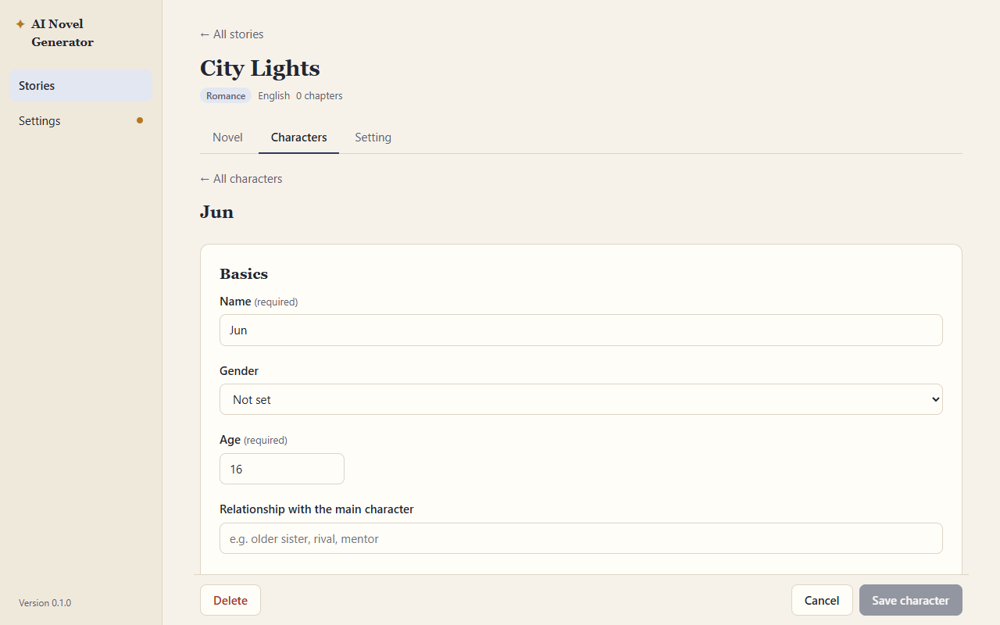
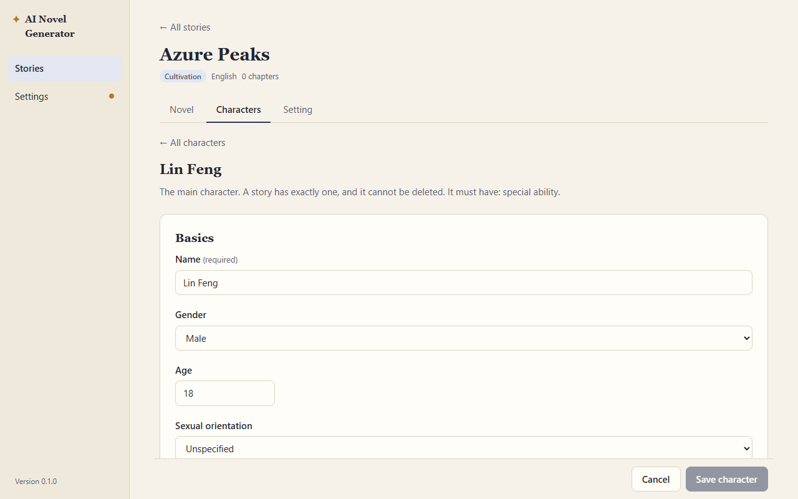
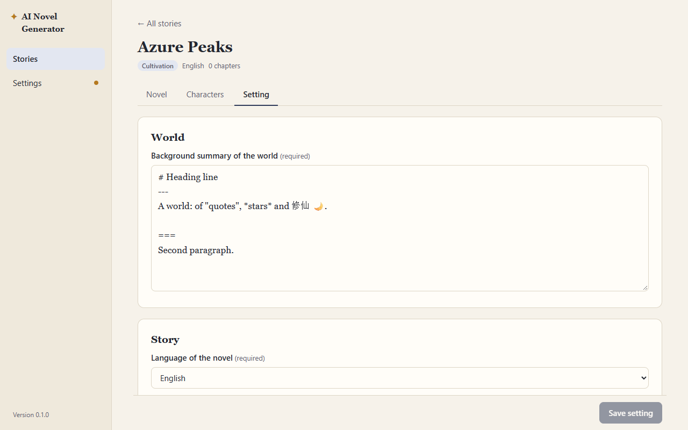
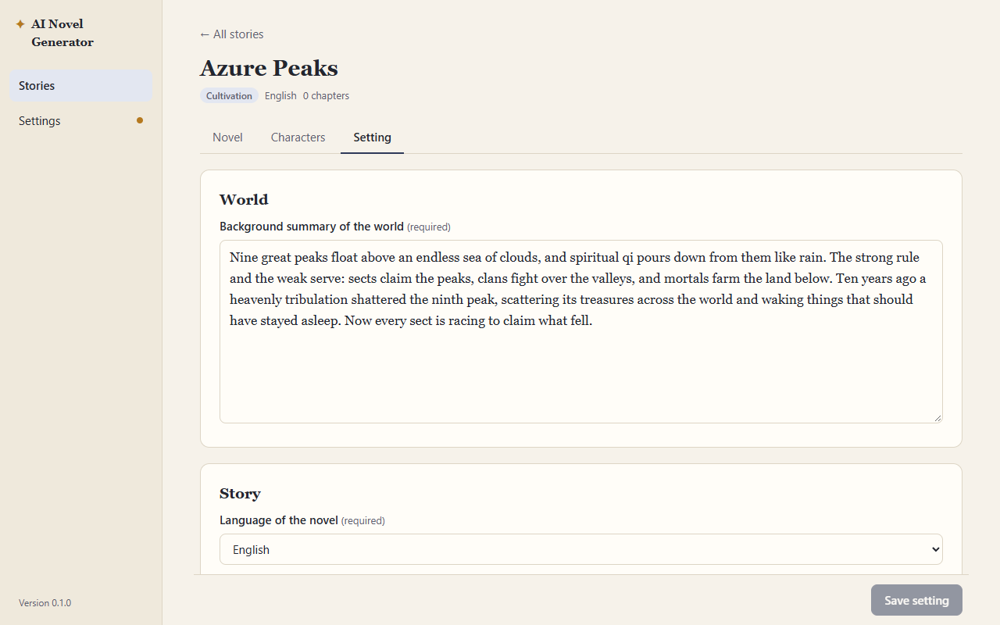
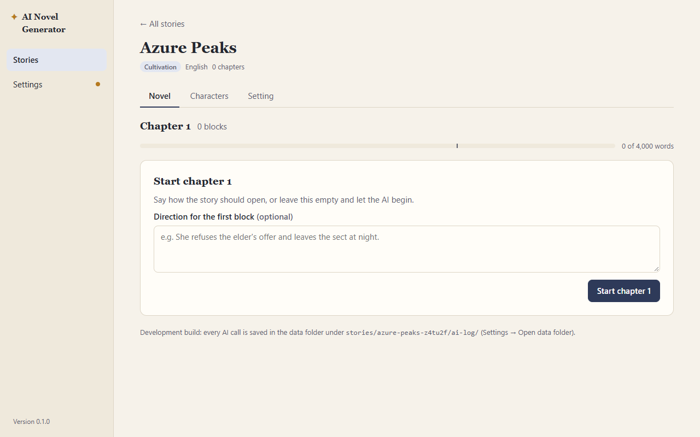
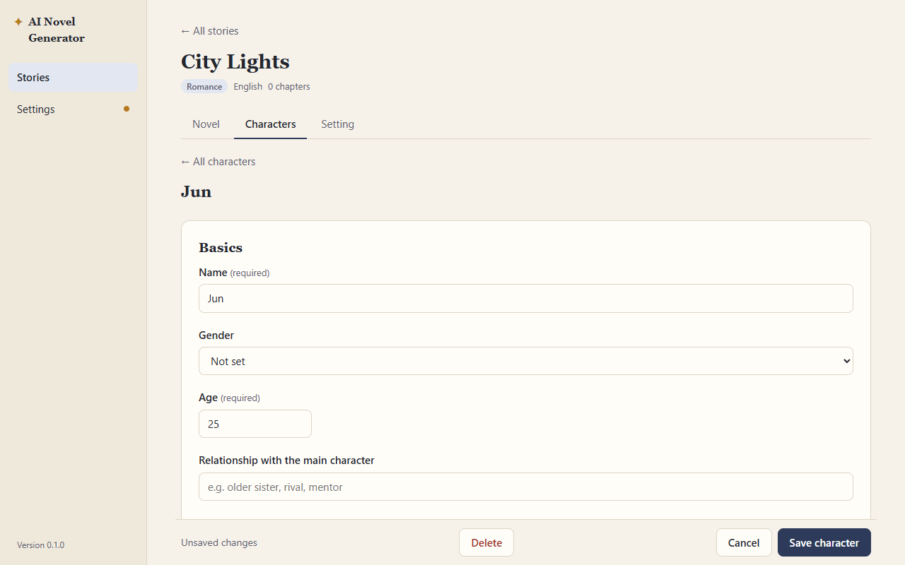
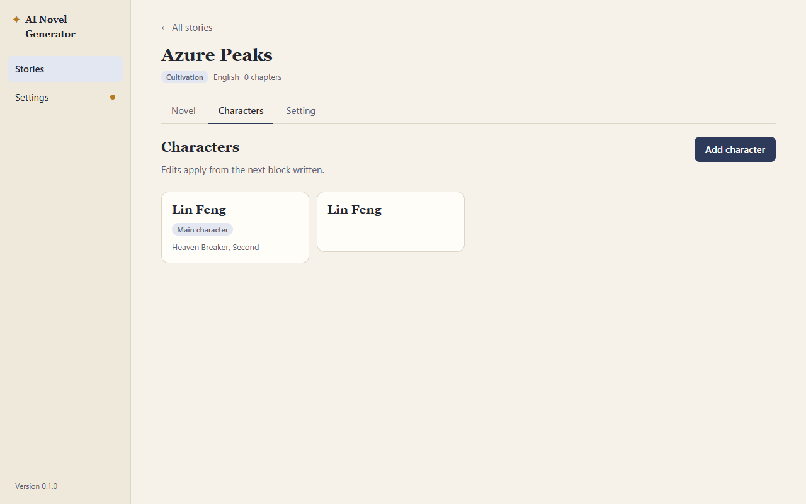

# QA: phase 2 re-verification (Setting and Character pages)

**Date:** 2026-10-13 · **Tester:** qa-tester agent · **Build:** browser preview (npm run dev), mock AI
**Scope:** phase 2 acceptance checks; spec 3, 4, 7, 8; decisions 5, 16, 30, 44, 45, 59 · **Time spent:** about 1.5 hours

## Summary

All eight acceptance checks still hold in the form flows, for both story types: every field in spec 7.2–7.4 and 8.2–8.4 is present, the tone limit, rank ladder, special ability, one-main-character and age rules are all enforced when saving through the form, and the Novel tab checklist reads the real state. A second main character is refused even when two windows race to create one. The biggest risk is outside the form: phase 2 promises that `setting.md` and character files are readable and hand-editable, and a hand-edited file goes around the rules without a warning. A romance character edited to age 16 opens with no flag and is sent to the AI as `age: 16` (P2-01). Two checks (AC 2, AC 3) are about a restart and files on disk, so they passed here only in the browser preview; a person still has to confirm them in the real app (steps below).

| Pass | Fail | Partial | Preview only | Not testable here |
| --- | --- | --- | --- | --- |
| 6 | 0 | 0 | 2 | 0 |

## Acceptance checks

| Phase · AC | Check (short) | Spec | Result | Evidence / note |
| --- | --- | --- | --- | --- |
| 2 · 1 | Cultivation fields on both pages for a cultivation story; romance fields for romance | 4, 7.2–7.4, 8.2–8.4 | Pass | Every field in the spec tables is present in both types. Romance hides Affection and Relationship stage for the main character; Relationship is hidden for the main character in both. Tone allows at most two (third option disabled). Affection slider 0–100; stage, love language and attachment options match 7.4. |
| 2 · 2 | Saved setting reopens with every value intact after a restart | 8 | Preview only | Every field set to a non-default value (Brief, God view, Long, Short story, Mature, The AI may decide, cruelty 5, Often, Fast, 2 tones, a 9th rank with stages, Chinese + quotes + `#` in a rank name, emoji, `---` and `===` lines in the background) reopened intact after a reload in both types ([010-reopen](shots/2026-10-13-phase-2/010-reopen.png)). A real restart needs the app. |
| 2 · 3 | `setting.md` and a character file are readable markdown with a YAML header | 3, decision 5 | Preview only | Stored files are a YAML header plus a markdown body; quotes, colons, `#` and Chinese are quoted correctly; a body that starts with `# Heading` and has a `---` line reads back correctly; notes are a markdown list. Opening the real files in a text editor needs the app. |
| 2 · 4 | A rank can only be picked from the story's rank ladder | 7.3, 8.3 | Pass | The Rank field is a list built from the ladder ("Name, Stage" per sub-stage). An off-ladder value (from a later ladder edit, or the example main character after a rank was renamed) shows "(not in the rank ladder)" and blocks Save ([022](shots/2026-10-13-phase-2/022-ladder-change.png)). An empty ladder and a ladder of blank names cannot be saved. See P2-04 and P2-05 for edges. |
| 2 · 5 | A cultivation main character cannot be saved without a special ability | 7.3 | Pass | Empty and spaces-only both refused: "Special ability is required." ([013](shots/2026-10-13-phase-2/013-main-noability.png)). Only by hand-editing the file can it be removed (P2-02). |
| 2 · 6 | A second main character cannot be created | 7.1 | Pass | "Create main character" disappears once one exists; "Add character" has no main-character switch; main character has no Delete. Two windows both on "New main character": the second save says "This story already has a main character. A story has exactly one." ([029](shots/2026-10-13-phase-2/029-rom-main-race.png)). Only a hand edit gets around it (P2-02). |
| 2 · 7 | A romance character under 18 cannot be saved | 7.2, decision 16 | Pass | Refused for 17, 17.9, 0 and empty, for a new character, the main character, and when editing an existing character down to 17 ([030](shots/2026-10-13-phase-2/030-rom-other.png)). Not enforced for a hand-edited file (P2-01). |
| 2 · 8 | Novel tab checklist ticks both items once setting and main character exist | 4 | Pass | New romance story: both unticked; after Save setting, "Fill in the world setting" ticked ([025](shots/2026-10-13-phase-2/025-rom-checklist1.png)); after the main character, the Novel page unlocks with "Start chapter 1". |

## Findings

### P2-01 · Major · Characters · A hand-edited romance character under 18 is accepted and sent to the AI

**Steps** (fresh profile, key `sk-test-valid~p2`):
1. Create a Romance story, click Save setting, create the main character as offered.
2. Add character "Jun", age 18, Create character.
3. Edit `characters/jun-….md` by hand and change `age: 18` to `age: 16` (in the preview: the `ang-file:stories/<id>/characters/jun-….md` localStorage entry; in the app: the file in the data folder). Reload.
4. Open Jun on the Characters tab. Then on the Novel tab, start chapter 1 with the direction "Chen Mei meets Jun at the café."

**Expected:** Characters in romance stories must be 18 or older (spec 7.2, decision 16). The phase notes say a hand-edited out-of-ladder rank is flagged; an under-age character should at least be flagged in the same way, and should not reach the prompt.
**Actual:** Jun opens with Age 16 and no message ([031](shots/2026-10-13-phase-2/031-handedit-age.png)); the list shows nothing either. The block request sent to the AI holds Jun's file with `age: 16` under "Characters in the scene" (`/v1/_last-request`). The age rule is only checked when the form is saved.
**Evidence:**  Request body excerpt: `### Jun\n---\nname: Jun\n…\nage: 16`
**Likely cause:** `validate()` runs only on Save in `src/pages/CharactersTab.tsx`; the prompt builder uses the file as it is. Reproduced once (deterministic).

### P2-02 · Minor · Characters · Hand-edited files can give two main characters or a main character with no special ability, with no warning

**Steps** (cultivation story with a saved setting, main character "Lin Feng" and a second character):
1. By hand, set `main_character: true` in the second character's file, and `special_ability: ""` in the main character's file. Reload.
2. Open the Characters tab, then the Novel tab.

**Expected:** Exactly one main character, and a cultivation main character must have a special ability (spec 7.1, 7.3). A broken file should be flagged the way an off-ladder rank is.
**Actual:** The list shows two characters labelled "Main character" ([035](shots/2026-10-13-phase-2/035-handedit-main.png)); opening the main character shows no message about the missing special ability (only the off-ladder rank, from an earlier step, is flagged); the Novel page stays unlocked and ready to write.
**Evidence:** 

### P2-03 · Minor · Accessibility · The character form's Background field and the Setting's world background share one id
**Status:** Fixed 2026-10-13. Form ids are unique per form (React useId). Covered by E2E-26.

**Steps** (any story):
1. Characters tab → Create main character (or open any character).
2. Look at the accessible name of the character's Background summary box; click the Setting tab and click the label "Background summary of the world".

**Expected:** Every input has its own label (qa-tester keyboard and accessibility checks).
**Actual:** Both forms render `id="f-background"`, and both stay mounted. The character's box is announced as "Background summary Background summary of the world (required)" ([016](shots/2026-10-13-phase-2/016-dupid.png)). With a character form open, the Setting's world background box loses its name (it cannot be found by its label), and clicking its label puts focus nowhere.
**Evidence:** 
**Likely cause:** `src/components/FieldForm.tsx:56`, `` const id = `f-${field.key}` ``: ids are not scoped per form, and both forms have a field keyed `background`.

### P2-04 · Minor · Setting · Duplicate rank names are accepted, and a blanked rank silently disappears

**Steps** (cultivation story, Setting tab):
1. Clear the name of rank 3 ("Foundation Establishment") and rename rank 4 to "Qi Refining" (same as rank 2). Save setting.

**Expected:** The ladder is an ordered list of ranks that characters pick from (spec 8.3); picking "Qi Refining, Early" should name one rank. A rank that is about to be removed should not vanish without a word.
**Actual:** "Setting saved." The ladder now has two "Qi Refining" ranks with the same stages, so a character's rank (stored by name) cannot tell which one, and rank 3 was dropped with no message ([006](shots/2026-10-13-phase-2/006-ladder-read.png)). An all-blank ladder is refused correctly ("Add at least one rank.").
**Evidence:** 

### P2-05 · Minor · Setting · Removing or renaming a rank a character uses gives no warning

**Steps** (cultivation story, main character at "Heaven Breaker, Second"):
1. Setting tab → Remove rank 9 ("Heaven Breaker") → Save setting.
2. Characters tab, then the Novel tab.

**Expected:** A character's rank comes from the ladder (spec 7.3). The user should learn that a character now has a rank outside it.
**Actual:** "Setting saved." with no warning. The character list still shows "Heaven Breaker, Second" with no flag; the problem only shows when the character is opened, and then Save is blocked until a rank is picked ([022](shots/2026-10-13-phase-2/022-ladder-change.png)). The Novel page stays open and the old rank goes into the prompt. The same happens to a new story's example main character if a rank is renamed before the main character is created ("Qi Refining, Early (not in the rank ladder)" is pre-selected, so "save without typing", decision 45, fails).
**Evidence:** 

### P2-06 · Minor · Characters · Unsaved character edits are lost without a warning when leaving the story

**Steps** (romance story with a character "Jun"):
1. Characters tab → open Jun → type in Occupation (the bar shows "Unsaved changes").
2. Click "← All stories". Reopen the story and Jun.

**Expected:** Same as unsaved Setting edits: leaving asks first (decision 59, E2E-22).
**Actual:** No question; the story list opens and the typed text is gone ([037](shots/2026-10-13-phase-2/037-unsaved-char.png)). (Switching tabs inside the story keeps the edits, which is good.)
**Evidence:** 

### P2-07 · Minor · Characters · Two characters can have the same name

**Steps** (cultivation story with main character "Lin Feng"):
1. Add character → Name "Lin Feng", Age 30 → Create character.

**Expected:** Not stated in the spec, but names are the key for "characters in the scene", "has appeared in a chapter" and End Chapter proposals (decisions 32, 40, 51), so a duplicate makes those ambiguous.
**Actual:** Saved; the list shows two "Lin Feng" ([020](shots/2026-10-13-phase-2/020-dupname.png)).
**Evidence:** 

### P2-08 · Polish · Characters · Opening a character form from the keyboard leaves focus on the page body

**Steps:** Characters tab → Tab to "Add character" → Enter.
**Expected:** Focus moves into the new form (Name), so keyboard users can type at once.
**Actual:** Focus is on `<body>`; the user has to Tab from the top of the page.

### P2-09 · Polish · Setting · Wording and confirmation

- "Reset to the default ladder" replaces the edited ladder at once with no confirmation (unsaved edits only; Save is still needed).
- The pinned notes placeholder in a Romance story is cultivation-flavoured ("Lin Feng owes the Azure Cloud Sect a life debt …").

## Suggestions

| # | Suggestion | Helps | Why | Size | Spec change? |
| --- | --- | --- | --- | --- | --- |
| S-01 | Run the form checks when a character or setting file is read, and show a banner on the Characters tab and Novel page when any file breaks a rule (age, one main character, special ability, rank) | Users who edit files by hand | Fixes P2-01, P2-02, P2-05 in one place; the files are meant to be readable and editable (decision 5) | Medium | Yes (say what happens to an invalid file) |
| S-02 | When Save setting would orphan a character's rank, list the affected characters and ask | Cultivation writers | P2-05 | Small | No |
| S-03 | Say what to do next in "This story already has a main character." (e.g. "Go back to All characters to edit it.") | Everyone | Plain-words messages say the next step (CLAUDE.md) | Small | No |

## E2E gaps

- Duplicate rank names in the ladder are refused; a blanked rank name is reported, not dropped (P2-04).
- A romance character file hand-edited to age 16 is flagged on open and not sent in the prompt (P2-01).
- Leaving a story with unsaved character edits asks first, like E2E-22 for the Setting (P2-06).
- Every input on the Characters and Setting tabs has a unique accessible name while the other tab's form is mounted (P2-03).
- Second main character refused when two windows both start one (passes today; spec 7.1).

## Exploration log

- Setting, both types: blank and spaces-only background refused with "Describe the world in a few sentences." and a red save bar ([004](shots/2026-10-13-phase-2/004-blank-bg.png)); tone limit of two; slider keyboard Home/End; markdown, YAML-looking text (`key: value?`), emoji and Chinese round-trip; notes with `- ` prefixes, blank lines and `#` round-trip as a list; empty lines in the sects list are dropped.
- Locking (spec 8.1): with a block in the draft, the Setting is read-only with a plain message and a disabled Save; notes can still be saved (decision 30); characters can still be edited ([036](shots/2026-10-13-phase-2/036-setting-locked.png)).
- Characters, both types: name blank or spaces refused; cultivation age −5 refused ("The lowest allowed value is 0."), 2.5 refused ("Enter a whole number."); non-main character can be marked Dead and shows "Dead" in the list; non-main has Delete, main has none.
- Narrow window 640×500 on the character form: no overlap, save bar stays visible.
- Enter in a form field does not submit (fine; buttons are explicit).

## Not covered

- **AC 2 in the real app (restart):** `npm run tauri dev` (or the installed app) → create a Cultivation story → on Setting change every field from its default (two tones, Brief, God view, Long, Short story, Mature, The AI may decide, cruelty 5, Often, Fast, add a rank with stages "First, Second", put Chinese and `"quotes"` in a rank name, a `---` line in the background) → Save setting → add a pinned note → close the app fully (also from the tray, if any) → start it again → open the story → Setting: every value must be as saved. Repeat for a Romance story (Era Historical, Trope Fake relationship, supportiveness 1, Fast, Several, Bittersweet).
- **AC 3 in the real app (files on disk):** Settings → Open data folder → `stories/<story-id>/` → open `setting.md` and `characters/<id>.md` in Notepad: each starts with `---`, YAML fields, `---`, then the background as plain paragraphs; Chinese shows correctly (UTF-8); `notes.md` is a `- ` list. While there, change a character's `age:` to 16 in a romance story, save, and reopen the character in the app to confirm P2-01 in the real app.
- Credential Manager and anything outside phase 2 (writing loop, End Chapter) were out of scope. Dialog focus trapping (QA-03) was not re-reported, as asked.
