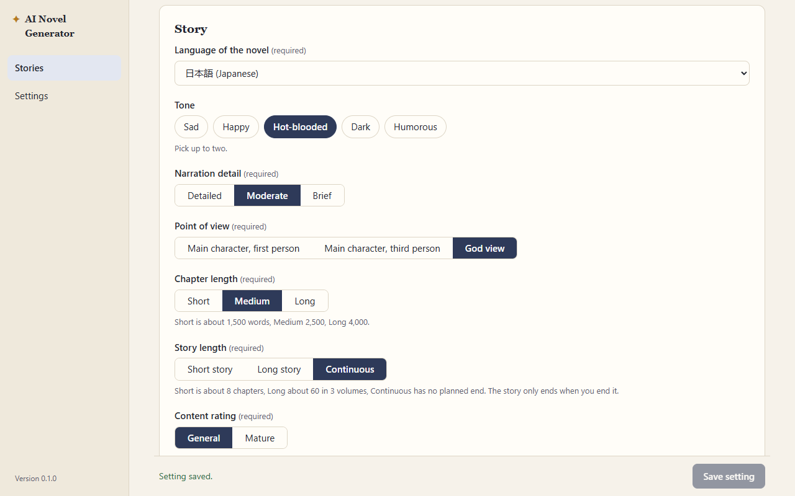

# QA: Phase 3 (novel page, core writing loop), re-verification

**Date:** 2026-10-13 · **Tester:** qa-tester agent · **Build:** browser preview (npm run dev), mock AI
**Scope:** `docs/phases/phase-3-novel-core-loop.md`, spec 5, 5.1, 5.2, 6.1, 6.3, 8.1, 9 (Novel page errors), decisions 36–43, 54, 58, 59 · **Time spent:** about 1.5 hours

## Summary

Phase 3 still holds up. Every acceptance check that the preview can test passed, including the spec rules behind them. The prompt reaches the AI in the spec 6.1 order with the main character's name, language, tone, point of view, direction and hint. Stop, network-off and dropped-stream failures never change the draft. The typed direction is kept after a failure, and the leave-mid-block guard from decision 59 works. One real gap: the Setting page is **not** locked while the first block of a chapter is being written. A setting saved in those seconds goes into the locked chapter, even though that first block was written with the old one (P3-01). The rest is small: focus is lost after each block (P3-02) and a cultivation placeholder appears in romance stories (P3-03). Not covered: real AI output quality for check 2 and a real app restart for check 8. Both need a person; the steps are below.

| Pass | Fail | Partial | Preview only | Not testable here |
| --- | --- | --- | --- | --- |
| 7 | 0 | 1 | 2 | 0 |

(Check 2 counts as Preview only: the prompt side passes, and the real-AI side needs a person. Check 8 counts as Preview only. Check 9 is Partial because of P3-01.)

## Acceptance checks

Story used for most checks: "Jade River" (cultivation, English), main character renamed to **Mei Lan** (female), tone changed to Dark + Humorous, narration Brief, point of view first person, rating Mature, a pinned note `PINNOTE-ALPHA`, plus the characters Old Bo, Ren and Shadow Wei (Inactive). Keys `sk-test-*~p3`; prompts read from `/v1/_last-request`.

| Phase · AC | Check (short) | Spec | Result | Evidence / note |
| --- | --- | --- | --- | --- |
| 3 · 1 | First block generates and streams onto the page | 5.1 | Pass | Empty first direction allowed (5.1 step 2). 150 ms after Start chapter 1, a partial sentence, "Writing…" and Stop are visible; then "1 block", 3 suggested actions, the counter at 61 of 2,500 words. [01](shots/2026-10-13-phase-3/01-first-block.png) |
| 3 · 2 | Uses the main character's name; matches language, tone, point of view | 6.1, 8.2 | Preview only | The system message sends `Language: … in English`, `Point of view: first person, told by the main character, Mei Lan`, `Tone: Dark, Humorous`, `Narration detail: Brief`, Mature rating. Also checked: Simplified Chinese + God view (`an all-seeing narrator in the third person`), Other → "Español" + third person (`staying close to the main character, Lin Feng`). Renaming the main character mid-chapter changes the next prompt to "Mei Ling" (spec 7.1). Whether a real AI *follows* these needs a person (see Not covered) |
| 3 · 3 | Suggested actions appear; choosing one writes the next block | 5.1 step 4, decision 42 | Pass | Three action buttons under every normal block. Double-clicking "Return to the sect before nightfall" sent **one** request and wrote one block; the prompt's last line was `Direction: Return to the sect before nightfall`. A block without the marker (`sk-test-stream-malformed`) shows "No suggestions came with this block. Type your own direction below." The flag line was never visible at any moment of the stream (MutationObserver, decision 54). [03](shots/2026-10-13-phase-3/03-suggested-action.png), [11](shots/2026-10-13-phase-3/11-no-suggestions.png) |
| 3 · 4 | A typed direction is followed in the next block | 5.1, 6.1 (9) | Pass | `Direction: DIR-B2: I pay the rent to Old Bo while Shadow Wei watches from the roof.` is the last line of the user message. Characters in the scene: Mei Lan + Old Bo. Inactive Shadow Wei was left out, and Ren was not matched inside "rent" (whole words, decision 40). Spaces-only direction keeps Write next block disabled; Ctrl+Enter submits. [02](shots/2026-10-13-phase-3/02-typed-direction.png) |
| 3 · 5 | Regenerate replaces the latest block; a hint is reflected | 5.2 | Pass | With hint "HINT-X", the prompt ends `Direction: Return to the sect…` / `Hint for this version: HINT-X…`, and the block being replaced is **not** in "Chapter 1 so far". "Version 2 of 2" is shown. A hint that names a character (Ren) adds them to the scene. Enter in the hint box regenerates. [04](shots/2026-10-13-phase-3/04-regenerate-hint.png) |
| 3 · 6 | An earlier version of the latest block can be restored | 5.2, decision 39 | Pass | Previous version → "Version 1 of 2", word count 179 → 172; still version 1 after a reload. After the next direction, `draft.json` holds one version per block (versions dropped), and the next prompt contains version 1's text, not version 2's. Draft shape matches spec 5.1 (direction, versions with text/actions/died/hint/createdAt, chosen). [05](shots/2026-10-13-phase-3/05-restore-after-reload.png) |
| 3 · 7 | Stop cancels a block without losing earlier blocks | 5.1 step 3, decision 38 | Pass | `sk-test-stream-slow`: Stop after 3 s → "Stopped. The unfinished block was discarded; the chapter is as it was.", still 4 blocks, `draft.json` byte-identical, typed direction kept. Also passes: Stop during a regenerate (the old version comes back, no version 2), Stop on the very first block (back to "Start chapter 1" with the direction kept), Stop then Write again at once, leaving the story mid-block (decision 59 dialog; Escape = stay). [06](shots/2026-10-13-phase-3/06-stop.png) |
| 3 · 8 | Closing the app mid-chapter and reopening shows the same blocks | 5.1, 3 | Preview only | Every step starts a new browser on the same profile: the blocks, word count and chosen version were the same each time. A reload during a streaming block reopens with the earlier blocks and no partial one. The real app's `draft/draft.json` on disk needs a person |
| 3 · 9 | Setting cannot be edited while the chapter has blocks | 8.1 | Partial | With blocks: every field, the rank ladder buttons and Save are disabled, with the note "The setting is locked while a chapter is being written…". Pinned notes stay editable (decision 30). [07](shots/2026-10-13-phase-3/07-setting-locked.png). **But** while the first block is still being written, the setting can be changed and saved, then locks with the new values ([P3-01](#p3-01--minor--setting-lock--the-setting-can-be-changed-while-the-first-block-of-a-chapter-is-being-written)) |
| 3 · 10 | Network off → clear error, draft unchanged | 9, decision 38 | Pass | `setOffline(true)` → alert "Could not reach the provider. Check your internet connection and the base URL."; draft identical; direction and hint kept; same for Regenerate. Back online, Write next block works without a reload. A dropped stream (`sk-test-stream-error`) gives "The connection to the provider broke off while the block was being written. Try again." with the draft identical. [08](shots/2026-10-13-phase-3/08-network-off.png) |

Prompt order (spec 6.1, decision 41) in every request: system message (instructions, genre fragments, answer format, language/point of view/tone/rating), then one user message: `## Setting` (YAML + world background) → `## Pinned story notes` → `## Characters in the scene` (main character first) → `## Chapter 1 so far` → `## Next block` (arc, length, direction, hint). Layers 5–7 are correctly absent in chapter 1.

## Findings

### P3-01 · Minor · Setting lock · The setting can be changed while the first block of a chapter is being written
**Status:** Fixed 2026-10-13 (decision 61). The Setting tab is locked while a block is being written. Covered by E2E-24.

**Steps** (key `sk-test-stream-slow~p3`):
1. Create a story, save the default setting (English, Main character third person), create the main character.
2. Novel → Start chapter 1.
3. While "Writing…" shows, open the Setting tab: every field is editable and there is no lock note. Change the language to 日本語 and the point of view to God view, click Save setting → "Setting saved."
4. Go back to Novel and let the block finish.

**Expected:** The setting is locked "from the first block of a chapter until End Chapter" (spec 8.1). The prompt for the first block was already sent with the old setting, so a change at this point should not be possible (or should at least not apply to the chapter already started).
**Actual:** The save goes through. The first block was written with `Language: … in English` and `third person, staying close to … Lin Feng` (confirmed in `_last-request`). Once it arrives, the setting locks with Japanese + God view. The story header now says 日本語, the chapter counter switches from words to characters, and every later block of this chapter is asked for in Japanese, God view. The user cannot undo this until End Chapter. Regenerating the first block is the only way to make the chapter consistent. Reproduced twice (stories "月光" and "Lock Gap").
**Evidence:** 
**Likely cause:** `isSettingLocked` in `src/lib/setting.ts` locks only when the saved draft has blocks, and the draft has no blocks until the first one arrives in full (decision 38). The Setting tab could also treat "a block is being written" as locked.

### P3-02 · Minor · Accessibility · Keyboard focus is lost after every block

**Steps** (key `sk-test-valid~p3`, a chapter with blocks):
1. Type a direction and press Ctrl+Enter (or press Enter in the Regenerate hint box).
2. When the block has arrived, press Tab.

**Expected:** Focus stays somewhere useful (the direction box, or the new block), so a keyboard user can carry on (spec 9 plain-words / usability; the qa checklist's keyboard rule).
**Actual:** `document.activeElement` is `<body>` after the block arrives. The control that had focus was replaced by Stop while writing. A keyboard user has to Tab from the top of the page through the side rail, tabs and every version/suggestion control to get back to the direction box, at every block.
**Evidence:** step `27-keys`: "focused after block: BODY"; reproduced for both Write next block and Regenerate.

### P3-03 · Polish · Wording · The direction placeholder talks about a sect in romance stories

**Steps:** Create a Romance story, finish the setting and main character, open Novel.
**Expected:** Example text that fits the story type (spec 4: story types are config, the genre shapes the prompts and forms).
**Actual:** Both "Direction for the first block" and "Your direction for the next block" show "e.g. She refuses the elder's offer and leaves the sect at night." in the romance story "月光". This placeholder fits cultivation only.
**Evidence:** accessibility snapshot of step `16-first-stream-lock` (placeholder on the 月光 Novel tab).
**Likely cause:** hard-coded in `src/pages/NovelTab.tsx` line 691. The story type file could carry an example direction.

## Suggestions

| # | Suggestion | Helps | Why | Size | Spec change? |
| --- | --- | --- | --- | --- | --- |
| S-01 | Show "Ctrl+Enter to write" next to Write next block | Keyboard users, fast writers | Ctrl+Enter works but nothing says so; plain Enter adds a newline, which a user may think is a bug | Small | No |
| S-02 | Show the user's own direction (and the hint, for a regenerated version) faintly above each block | Writers re-reading a chapter | Only the mock echoes the direction. With a real AI the user cannot see what they asked for, so they cannot judge "was it followed" or choose between versions | Medium | Yes (5.1 reading view) |
| S-03 | When regenerating, tell the AI what the replaced version said, briefly, and ask for something different | Writers using Regenerate without a hint | The replaced block is (correctly) left out of the prompt, so a regenerate without a hint is just another sample of the same prompt and may come back very similar | Small | Yes (6.1) |

## E2E gaps

- The Setting tab is locked (or refuses to save) while the first block of chapter 1 is being written; the prompt's language matches the setting the chapter is locked with (spec 8.1, P3-01).
- After a block arrives via Ctrl+Enter, focus is on the direction box (P3-02).
- Double-clicking a suggested action sends one request and writes one block (decision 42). It passes today, but no test guards it.
- Stop during a regenerate restores the earlier version and leaves `draft.json` unchanged (decision 38). E2E-11 covers Stop on a new block only.
- Stop on the very first block returns to "Start chapter 1" with the direction kept.

## Exploration log

- **Impatient:** double-clicked a suggested action (one request), clicked Write right after Stop (works, the new block streams), reloaded mid-stream (earlier blocks kept, no partial block, no warning on reload; the app lands on the story list), and left the story mid-block (decision 59 dialog, "Stay" / "Leave and discard the block", Escape = stay; after leaving, the draft is unchanged and the direction is still there on return). All fine.
- **Careless:** spaces-only direction (Write stays disabled), 6,000-character direction (accepted; no limit shown), emoji, Chinese, quotes, `*`, `---` and a `## Next block` line inside a direction (sent verbatim as the last lines of the prompt; nothing broke). A Chinese title gives a story id like `story-4g1ocv`. Fine.
- **Unlucky:** network off, dropped stream, regenerate under both. Messages are plain and say what to do, the draft is never touched, and recovery needs no reload. The previous error alert stays until the next attempt succeeds; that is fine. Every successful block logs `POST …/chat/completions net::ERR_ABORTED` in the network log. This is the app cancelling the reader after `[DONE]` (`src/lib/ai.ts`), on purpose and harmless.
- **Characters in the scene:** main character always first; named character added from the direction, from the current chapter's text and from a regenerate hint; inactive character left out even when named; no false match inside a longer word; Chinese name 小月 matched inside a Chinese direction with no spaces.
- **Returning:** blocks, chosen version and word count survive every browser restart; an unsent direction/hint is gone after a restart, which decision 59 expects.

## Not covered

- **Check 2 with a real AI (tone, language, point of view, main character's name).** The mock writes fixed English text. Person: in the real app (`npm run tauri dev`) with a real key, create a story with a non-default main character name (e.g. "Mei Lan"), language 简体中文, point of view "Main character, first person", tone "Dark" + "Humorous". Write 5–6 blocks. Confirm: the text is Chinese, narrated as 我 by Mei Lan (her name appears when others address her), the suggested actions are Chinese, and the mood is dark with humour. Then open the newest file in `ai-log/` (Settings → Open data folder → `stories/<id>/ai-log/`) and confirm the same four instructions are in the system message. Tone is already listed in Known gaps (progress.md), so re-check it over a full chapter.
- **Check 8 in the real app.** Person: write 3 blocks, regenerate the third and go back to version 1, then close the window with the X button. Reopen from the Start menu, open the story → Novel: the same 3 blocks, "Version 1 of 2". Also open `draft/draft.json` in the data folder and confirm it has 3 blocks. Repeat once with the window closed *while* a block is being written: on reopen, the earlier blocks are there and there is no half block.
- Spec 6.3 shapes the mock cannot produce (empty answer, `yes` flag without the marker, more than three actions, lower-case marker). These are covered by unit tests U-BL and were not checked by hand.
- Out of scope (seen in passing): the character form's "Background summary" field has the accessible name "Background summary Background summary of the world (required)", probably a label `for` id shared with the Setting form. It belongs to phase 2 and should be checked there.
- Dialog focus trapping (QA-03) was not re-reported, as asked.
