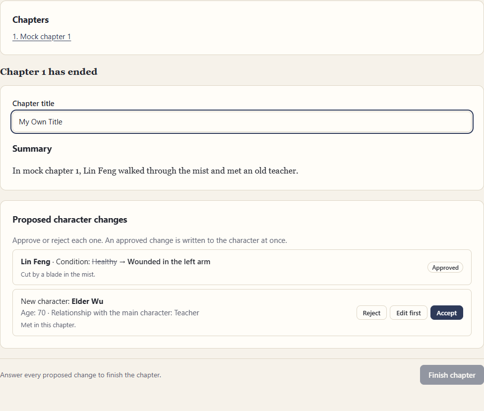
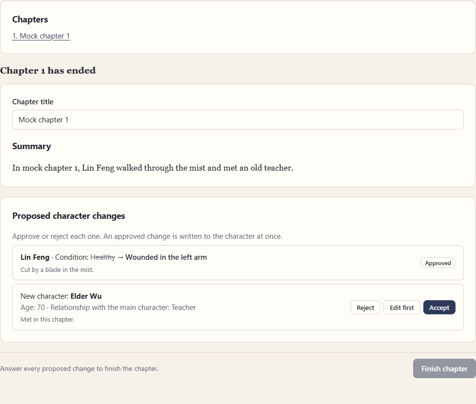
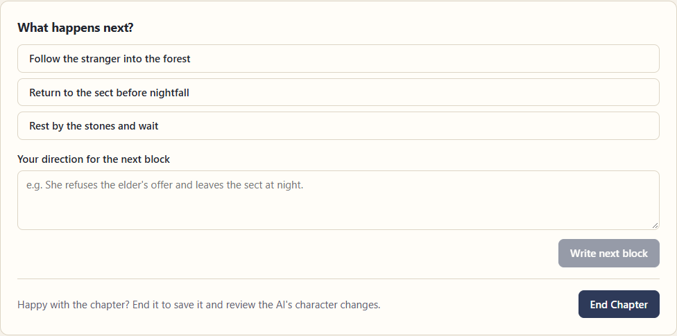
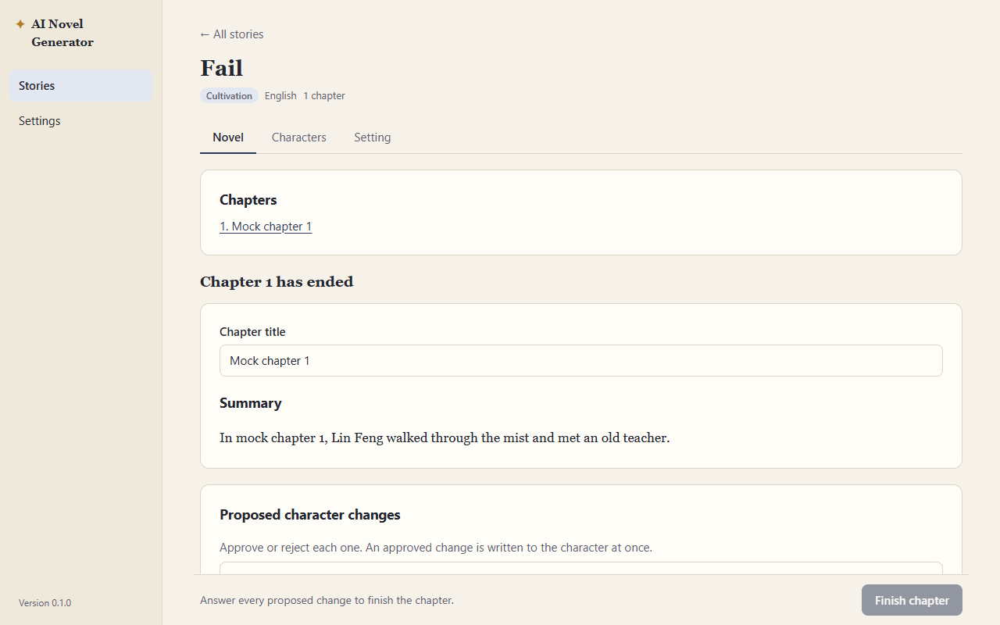

# QA: phase 4 (re-verification)

**Date:** 2026-10-13 · **Tester:** qa-tester agent · **Build:** browser preview (npm run dev), mock AI
**Scope:** phase 4 acceptance checks, spec 5.3–5.7, 6.1, 7.5, decisions 47–54 · **Time spent:** about 1.5 hours

## Summary

Phase 4 holds up. All 16 checks were retested against the full spec rule behind them, and none fails outright. The limits, End Chapter, retry, death, End story, epilogue, Completed and Story length all behave as spec 5.3–5.7 and decisions 49–52 describe. The preview storage showed the expected files at each step (`chapter.md`, `summary.md`, `review.json`, `snapshot/`, story `summary.md`, and the draft removed only after the review). Check 11 (Never) is Partial: the instruction is sent, but when the AI flags a death anyway, the app still offers "Accept the death". The other main risks are an edited chapter title that is lost if the user leaves during the review, which goes against "closing the app during the review loses nothing" (spec 5.4), and an epilogue prompt that tells a Continuous story "never resolve the main conflict". Files on a real disk, a real restart and real AI output still need a person (see Not covered).

| Pass | Fail | Partial | Preview only | Not testable here |
| --- | --- | --- | --- | --- |
| 13 | 0 | 1 | 2 | 0 |

## Acceptance checks

| Phase · AC | Check (short) | Spec | Result | Evidence / note |
| --- | --- | --- | --- | --- |
| 4 · 1 | Progress bar tracks length against target | 5.3 | Pass | Short: "941 of 1,500 words", then "1,869 … · target reached", then "2,797 … · length limit reached". The count matches the real word count of the text (941). Chinese + Short shows "0 of 2,500 characters" and counts 204 characters for 204 non-space characters (decision 48). |
| 4 · 2 | Past the soft limit, blocks move toward an ending | 5.3 | Pass | The block after 1,869 words carries "The chapter has reached its target length: steer toward a natural chapter ending in this block or the next." End Chapter turns `btn primary` (it was `btn` before). See P4-04 for the overshoot. |
| 4 · 3 | At the hard limit, the chapter ends after a concluding block | 5.3, dec. 49 | Pass | At 2,797 words (over 2,250), the next request says "This block is the chapter's conclusion…". Afterwards there is no direction box or suggestions, only "The chapter has reached its length limit" + End Chapter. The concluding block can still be regenerated and its hint keeps the conclusion line. [shot](shots/2026-10-13-phase-4/006-block4-conclusion.png). See P4-04, P4-05. |
| 4 · 4 | `chapters/001/` holds `chapter.md`, `summary.md`, `snapshot/` | 3, 5.4 | Preview only | Preview storage after the review: `chapters/001/chapter.md`, `summary.md` (YAML title), `review.json`, `snapshot/setting.md`, `snapshot/characters/*.md`. `draft/draft.json` stays during the review and is removed at Finish. `chapter.md` holds the chosen (regenerated) version and no format lines. Real disk: see Not covered. |
| 4 · 5 | Approved change written to the character file; rejected one not | 5.4, 7.5 | Pass | Approve wrote `condition: Wounded in the left arm` at once (before Finish). The old value "Healthy" came from the file. The mock's invalid "Nobody Known" proposal was dropped. A rejected change left the file unchanged (chapter 2, Death story). When the value was already applied, chapter 2's identical proposal was dropped too. |
| 4 · 6 | Accepted new character appears on the Character page | 5.4, 7.5 | Pass | "Accept" → Elder Wu (Teacher, age 70) on the Characters tab. "Edit first" checks the form (blank name → "Name is required.") and saves the edited character. See P4-07. |
| 4 · 7 | Chapter 2 continues from chapter 1 without restating | 6.1, 6.2 | Preview only | The chapter 2 prompt holds "The story so far", "Recent chapters" (`Chapter 1, "The Long Road": …`) and "End of the previous chapter" (307 words, Balanced = 300). Elder Wu is in "Characters in the scene". Whether the AI's text really continues needs a real provider. |
| 4 · 8 | Earlier chapter opens read-only | 5.6 | Pass | "1. The Long Road" opens "Chapter 1 · read-only". It has no inputs, no contenteditable and only a "← Back to the current chapter" button. The text is the accepted version. The same holds during a pending summary and in a Completed story. |
| 4 · 9 | Setting editable between chapters; chapter 1 snapshot keeps old values | 8.1 | Pass | Between chapters the Setting tab is unlocked. The background and death setting were changed and saved. `setting.md` has the new values, `chapters/001/snapshot/setting.md` keeps the old ones, and the chapter 2 prompt uses the new background. It is locked during the review, the pending summary and the epilogue. See P4-06. |
| 4 · 10 | End Chapter call fails → text kept, Retry completes | 5.4 | Pass | `sk-test-end-chapter-fail`: "The provider stopped with an error: Mock End Chapter failure. Try again." and "Chapter 1 is saved". The list shows "summary pending", `chapter.md` exists and there is no Start chapter 2 or End story. After a reload the state is the same, the chapter opens read-only and the setting is locked. A double-clicked retry sends one call. After switching the key, Retry opens the review. [shot](shots/2026-10-13-phase-4/031-endchapter-fail.png) |
| 4 · 11 | Never: a direction asking for the death does not kill the MC | 5.5 | Partial | The system prompt says "The main character never dies in this story, even if a direction asks for it." But if the AI still returns `DIED: yes`, the app pauses and offers "Accept the death" (P4-02). Whether a real AI obeys needs a real provider. |
| 4 · 12 | Accepted death → chapter ends, epilogue, Completed | 5.5, dec. 52 | Pass | Death pause: no direction box and no End Chapter. It survives a reload. Switching back to the dying version brings the pause back. Accept → confirm → review → "Write the epilogue" with "The main character has died." The epilogue prompt names the death. Accepting it creates `chapters/002/` titled "Epilogue" with a snapshot and no End Chapter call, and `story.json` gets `status: completed`, `ending: death`. [shot](shots/2026-10-13-phase-4/029-death-completed.png) |
| 4 · 13 | "End story" writes an epilogue and marks Completed | 5.5 | Pass | End story appears only between chapters (not before chapter 1, not during a review or a pending summary). Escape closes its dialog. The epilogue screen survives a reload. The prompt asks for about 1,500 words (Short) and follows the optional direction. Regenerate works, and the accepted version is the one chosen (version 1 of 2). See P4-03. |
| 4 · 14 | Completed story readable, no new chapter | 5.5 | Pass | After a reload: "Completed" in the story list and header, "The story is complete". No Start, Write, End Chapter or End story buttons. All 3 chapters, the epilogue included, open read-only. [shot](shots/2026-10-13-phase-4/026-completed.png) |
| 4 · 15 | Short story: finale in chapter 7/8 log; End story highlighted after chapter 8 | 5.7, dec. 47 | Pass | The arc line runs ch1–2 "set-up", ch3–6 "rising conflict", ch7–8 "one of the last two: steer toward the finale…". The chapter 7 `ai-log` file contains it. End story is `btn` before chapters 2–8 and `btn primary` after chapter 8, with "The planned 8 chapters are written. You can end the story here with an epilogue, or go on." Chapter 9 can still start ("past the planned 8 chapters"). [shot](shots/2026-10-13-phase-4/038-after-ch8.png) |
| 4 · 16 | Continuous: instructions say no planned end | 5.7 | Pass | System prompt: "Story length: continuous, with no planned end…". Arc line: "Chapter 1 of a continuous story…". Long story is checked too: "Chapter 2 of about 60, the opening of volume 1". |

## Findings

### P4-01 · Minor · Chapter review · An edited chapter title is lost when the user leaves during the review
**Status:** Fixed 2026-10-13 (decision 60). The title is saved as it is typed. Covered by E2E-25.

**Steps** (key `sk-test-stream-long`, any story with Chapter length Short):
1. Write a block and click End Chapter → End Chapter. The review opens with the title "Mock chapter 1".
2. Type "My Own Title" in Chapter title. Approve the first proposal, which moves focus out of the field.
3. Click "← All stories" (no question is asked), then open the story again. A reload does the same.

**Expected:** "Closing the app during the review loses nothing" (spec 5.4, decision 50). The title the user typed is kept, or leaving asks first, like unsaved Setting edits (decision 59).
**Actual:** The title is back to "Mock chapter 1". `chapters/001/summary.md` still holds the AI title until Finish chapter. The approved proposal is kept. Reproduced twice (Limits and Limits2 stories).
**Evidence:**  
**Likely cause:** `src/pages/ChapterReview.tsx`. The title lives only in `useState` and is written at Finish.

### P4-02 · Minor · Main character death · With "Never", the app still offers "Accept the death"

**Status:** Fixed 2026-10-14 (decision 62). Under Never a death can only be regenerated; End Chapter also refuses a death. Covered by E2E-27 and unit tests.

**Steps** (key `sk-test-stream-died`):
1. Set Main character death to Never and save. Start a chapter.
2. Write a block with the direction "Lin Feng dies."

**Expected:** Spec 5.5: under Never "the main character always survives, even if a direction asks otherwise". The spec does not say what happens when the AI breaks this rule, but the user chose Never, so the story should not be able to end by death. For example, offer only Regenerate, or warn that the AI ignored the setting.
**Actual:** The page pauses with "The main character died in this block" and offers "Accept the death", which ends the story by death. The prompt itself is correct.
**Evidence:** 
**Note:** This is a spec gap. Decide the rule in the spec first.

### P4-03 · Minor · Prompt · The epilogue of a Continuous story is told "never resolve the main conflict for good"

**Steps** (key `sk-test-valid~p4`, Story length Continuous, the default):
1. Finish chapter 1 and click End story → End story → Write the epilogue.
2. Fetch `/v1/_last-request` for the key.

**Expected:** The epilogue is "the story's final chapter" (spec 5.5). The pacing line of spec 5.7 ("the main conflict is never resolved for good") should not apply to it.
**Actual:** The epilogue system message says "Bring the story to its close…" and, a few lines later, "Story length: continuous, with no planned end. Let one arc lead into the next and never resolve the main conflict for good." A real AI may write an open-ended epilogue. Continuous is the default, so most stories that end will hit this.
**Likely cause:** `src/lib/prompt.ts`. The epilogue reuses the "How to write" lines, story length included.

### P4-04 · Minor · Chapter length · Chapters overshoot the hard limit by up to a whole block before the conclusion

**Steps** (key `sk-test-stream-long`, Chapter length Short):
1. Write blocks until the count passes 2,250 words.

**Expected:** Spec 5.3: hard limit 2,250 words (150%).
**Actual:** The block that crosses 2,250 is written with only the soft-limit instruction. The conclusion is asked for in the block after it. The mock chapter ended at 3,725 words (248% of target). With real 300–500-word blocks that is about 2,600–3,000 words, so the hard limit works as "150% plus one block, then one more". This matches the wording of decision 49 ("at the hard limit, the next block is the conclusion"). Deciding it is a docs choice: either accept the overshoot in the spec, or ask for the conclusion when the next block would likely pass the limit (for example, words + one typical block ≥ hard limit).
**Evidence:** 

### P4-05 · Polish · Chapter length · Past the hard limit the page does not say the next block will be the last

**Steps:** As P4-04, and stop after the block that passes 2,250 words.
**Expected:** The user can tell that the next block will close the chapter (spec 5.3, plain words that say what comes next).
**Actual:** The bar says "length limit reached", but the controls look like every other block. The hint even falls back from "The chapter has reached its target length…" to the general "Happy with the chapter? End it…". The suggested actions still point onward.
**Evidence:** 

### P4-06 · Minor · Setting page / accessibility · Two fields share the id `f-background`
**Status:** Fixed 2026-10-13, with P2-03. Covered by E2E-26.

**Steps** (any story with a main character):
1. Characters tab → open Lin Feng.
2. Setting tab → click the label "Background summary of the world".

**Expected:** The label focuses the Setting background box, and the box is named by its label.
**Actual:** `document.querySelectorAll("#f-background")` returns 2 elements (Setting and Character background, both mounted). The Setting label points to the hidden Character box, so the click focuses nothing. A screen reader names the Setting box by its placeholder ("Where and when the story happens…"). `getByLabel(/Background summary of the world/)` times out. Found while editing the setting for check 9.
**Likely cause:** `src/pages/SettingTab.tsx:109` and `src/pages/CharactersTab.tsx:242` both use `id="f-background"`.

### P4-07 · Polish · Chapter review · After "Edit first", the card still shows the AI's original character

**Steps** (key `sk-test-valid`): In the review, click "Edit first" on Elder Wu, change the name to "Elder Wu Zhen" and the age to 71, and save.
**Expected:** The card shows what was saved.
**Actual:** The card reads "New character: Elder Wu · Age: 70" with "Approved". The saved file is `elder-wu-zhen-….md`, `age: 71`.
**Evidence:** 

### P4-08 · Polish · Progress bar · The value goes past the maximum and has no text value

**Steps:** Write past the target (key `sk-test-stream-long`, Short).
**Expected:** A screen reader hears the same thing as the visible text.
**Actual:** `progressbar "Chapter length"` has `aria-valuenow=3725`, `aria-valuemax=1500` and no `aria-valuetext`. The value is out of range, so readers announce 248% or clamp it. The visible "3,725 of 1,500 words · length limit reached" is not attached to the bar.

### P4-09 · Polish · Death pause · Two regenerate buttons with nearly the same name

**Steps:** Get a died flag (key `sk-test-stream-died`).
**Actual:** The page shows both "Regenerate block" (with the hint box, under the text) and "Regenerate the block" (in the pause box). They do the same thing, and it is unclear which one to use or whether the hint applies to the second.

## Suggestions

| # | Suggestion | Helps | Why | Size | Spec change? |
| --- | --- | --- | --- | --- | --- |
| S-01 | After an accepted death, tell the End Chapter call that the main character died, or set the main character's status to Dead as a proposal | Writers | Today the End Chapter prompt never mentions the death, and Lin Feng stays `status: Alive` in the character file and both snapshots of a death-ended story | Small | Yes |
| S-02 | Let Approve, Reject and Accept be undone until Finish chapter | Everyone | A misclick on Approve is written at once and cannot be taken back in the review | Small–medium | Yes (5.4) |
| S-03 | When the title is left blank, say that the AI's title will be used | Writers | A blank title silently becomes "Mock chapter 9", which is fine but surprising | Small | No |
| S-04 | In a Completed story, rename "← Back to the current chapter" to "← Back" | Readers | There is no current chapter after the epilogue | Small | No |
| S-05 | Name the climax in the Short story arc (for example chapter 6 "the climax", chapters 7–8 "resolution") | Writers | Spec 5.7 lists "climax and resolution". The arc line goes straight from "rising conflict" (3–6) to "finale" (7–8). Tune with real output | Small | No |

## E2E gaps

- The review title typed, then leaving the story and coming back, keeps the title (P4-01).
- The epilogue prompt for a Continuous story does not include "never resolve" (P4-03, a unit test in `prompt.test.ts` is enough).
- The Setting edited between chapters 1 and 2: the new value is in the chapter 2 prompt, and `chapters/001/snapshot/setting.md` keeps the old value (check 9; not in E2E-16).
- Accepting a proposed new character puts it on the Characters tab (check 6; E2E-16 only rejects Elder Wu).
- Short story: the arc line of chapter 7 has the finale, and End story is highlighted only after chapter 8 (check 15; not covered by E2E-16..20).
- Under Never, a died flag does not offer Accept the death, once P4-02 is decided.
- Double-clicking End Chapter confirm, Finish chapter and "Try the summary again" sends one call and makes one chapter folder (passed today; worth guarding).

## Exploration log

- **Reload mid-review:** the approved proposal and pending ones are kept; the typed title is not (P4-01). The death pause, the epilogue screen, a pending summary and a Completed story all survive a reload.
- **Double clicks:** End Chapter confirm, Reject, Finish chapter, Accept the epilogue and Try the summary again each act once. There was one End Chapter log per chapter and no duplicate chapter folders.
- **Versions:** switching back to the dying version brings the death pause back, and the next version clears it. The regenerated concluding block is what ends up in `chapter.md`, and the accepted epilogue is the version on screen (version 1 of 2).
- **Repeat proposals:** in chapter 2 the mock re-proposed the same condition and Elder Wu (who already exists). Both were dropped, and the review said "The AI proposed no character changes for this chapter."
- **Edit first** with a blank name shows "Name is required." and saves nothing.
- **Blank title** (spaces only) on Finish falls back to the AI title (S-03).
- **Keyboard:** the review tab order is title → Reject → Edit first → Accept (Finish is skipped while disabled). Escape closes the End story dialog.
- **Chinese + Long story** between chapters: the bar switches to characters (2,500 for Short) and the arc names volume 1.
- **Locks:** the setting is locked during the review, a pending summary and the epilogue, and unlocked between chapters. Start chapter 2+ needs a direction (spec 5.1 makes it optional only for chapter 1).

## Not covered

- **Files on a real disk (check 4)**: run `npm run mock-ai` and `npm run tauri dev`, then use key `sk-test-valid`. Write a block and End Chapter. In the review, Settings → Open data folder → `stories/<id>/chapters/001/`: `chapter.md` and `summary.md` exist, and `review.json` exists. `snapshot/` does not exist yet. Finish the chapter: `snapshot/setting.md` and `snapshot/characters/*.md` appear and `draft/` is gone. Try to edit `chapter.md` in the app and confirm there is no way to.
- **Real restart during the review (spec 5.4)**: in `npm run tauri dev`, End Chapter, approve one proposal, close the window, and start again. The review reopens with that proposal approved. Also expect P4-01: a typed title is lost.
- **Real AI (checks 7 and 11, story length tone)**: with a real key, write chapter 1 with a named side character and a clear event, end it, then start chapter 2 with only "Continue". The text should pick up the event and the character without being told. Set Never and direct "X is killed": the text should keep X alive and the flag should read `no`. Check `ai-log/` for both.
- Dialog focus trapping (QA-03, deferred) and QA-06 (no way back after confirming End story) were not retested by request. QA-06 did not block check 13.
- Broad journeys, themes and font sizes, and small windows were out of scope.
