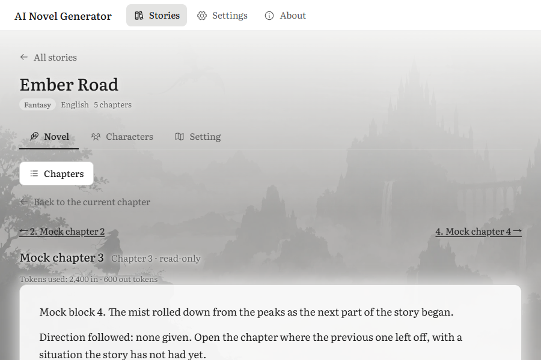
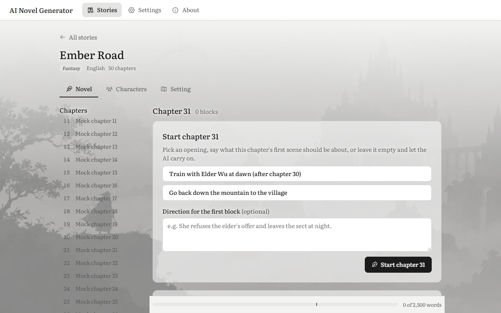
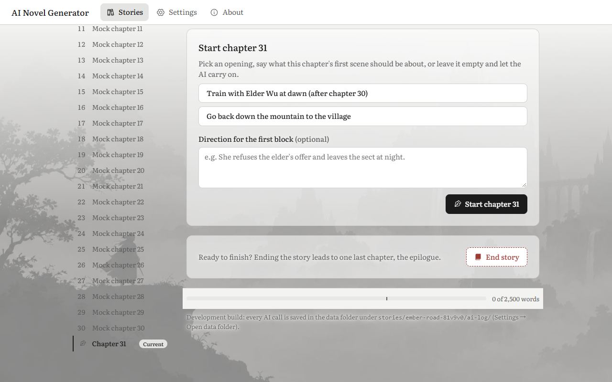
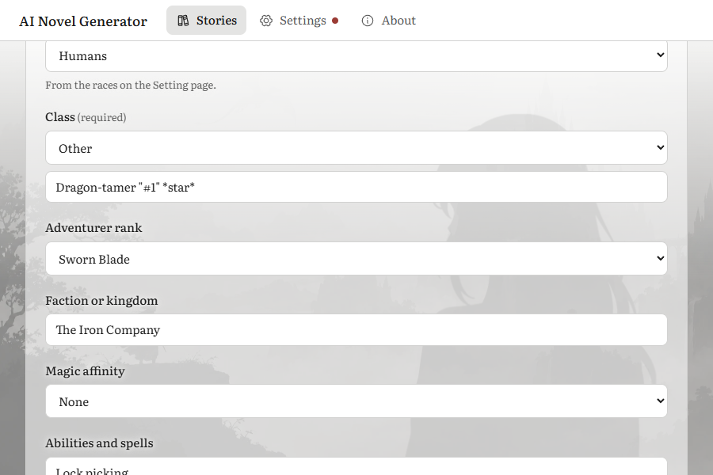
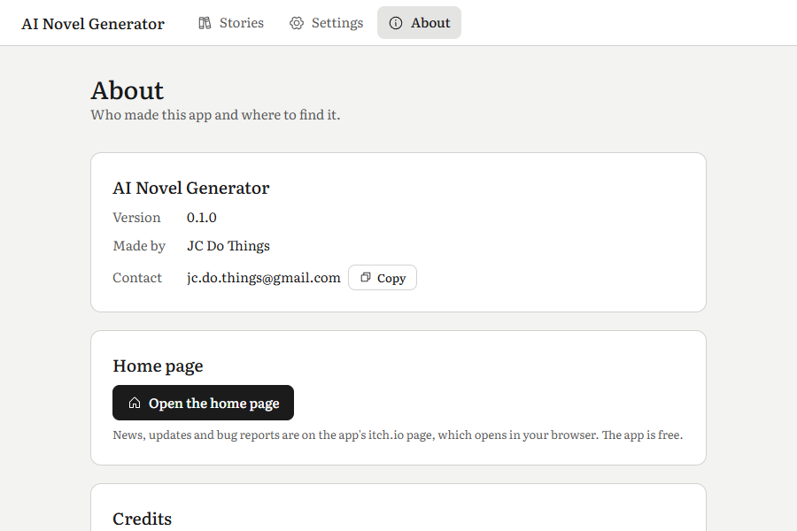
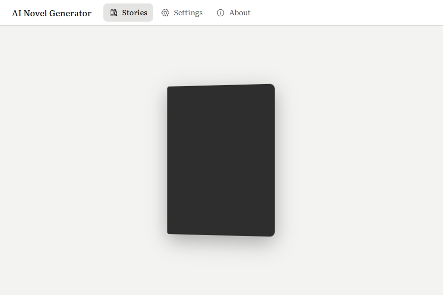
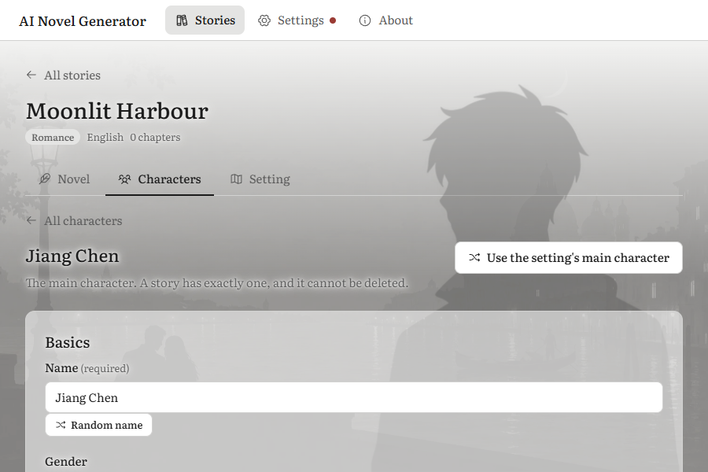

# QA: Phase 7, look and feel (v0.3)

**Date:** 2026-10-29 · **Tester:** qa-tester agent · **Build:** browser preview (npm run dev), mock AI
**Scope:** Phase 7 acceptance checks; spec 1, 4, 7.6, 8.5, 9, 10, 12; decisions 94–118 · **Time spent:** about 3 hours

## Summary

Phase 7 holds up well in the preview. The top bar, About page, bookshelf, art, Background art switch, fantasy type and animations all work. Nothing is cut off or overlaps at 900 × 600 in either theme or any of the three UI languages. Reduced motion stops every animation, and a click during the book opening goes straight through to what was clicked. The biggest risks are readability and the chapter list:

- Secondary (muted) text placed over the art fails the spec's WCAG AA contrast rule by a wide margin (QA-01).
- With many chapters, the wide chapter side list runs past the bottom of the window, so the current chapter it scrolls to is not visible (QA-02).
- Clearing the adventurer ranks does not hide the rank field on the default main character, and a rank the user turned off is still saved and sent to the AI (QA-03).

Not covered: the real Tauri window, the installer, opening the default browser, the Windows "Animation effects" switch, and the person-based icon test (AC 2).

| Pass | Fail | Partial | Preview only | Not testable here |
| --- | --- | --- | --- | --- |
| 1 | 0 | 1 | 3 | 2 |

## Acceptance checks

| Phase · AC | Check (short) | Spec | Result | Evidence / note |
| --- | --- | --- | --- | --- |
| 7 · 1 | Every page at 900 × 600, light and dark, en / 简体 / 繁體 | 12, 11 | Preview only | Script visited Settings, setup guide, About, bookshelf, Novel, Chapters panel, reader, Characters, character sheet, Setting and the review in 6 combinations (3 languages × 2 themes). No horizontal page scroll, no clipped text, nothing off the right edge. The chapter list is behind the "Chapters" button below 1100 px (1099 → button, 1100 → side list). Shots: [zh-Hans About](shots/2026-10-29-phase-7/i18n-zh-Hans-light-about.png), [zh-Hant dark shelf](shots/2026-10-29-phase-7/i18n-zh-Hant-dark-shelf.png), [zh-Hant sheet](shots/2026-10-29-phase-7/i18n-zh-Hant-light-charsheet.png). The real window's minimum size still needs checking in Tauri. |
| 7 · 2 | A new user tells main buttons apart by icon alone | 12.2 | Not testable here | Needs a person. Every main button has an icon and a label. Risks for this check are in QA-07 (End Chapter and End story icons nearly the same; Randomize's shuffle icon reused for a non-random action; no "read" icon). |
| 7 · 3 | Fantasy story created and written to the end with no typing beyond directions | 7.6, 8.5 | Pass | "Ember Road" (English) and "长夜行者的最后旅程" (简体中文): setting saved as it was, main character from the curated set (race and rank from the set's lists), blocks written with the suggested actions, chapters ended, End story, epilogue accepted. The spine shows the ribbon and "Completed" ([shelf](shots/2026-10-29-phase-7/spines-zoom.png)). Only the title was typed, as for the other types. The prompt sends race, class, rank and choices in Chinese for the Chinese story (`_last-request`: `class: 盗贼`, `adventurer_rank: 宣誓之刃`). |
| 7 · 4 | Own background per type; right figure per gender; figures fit every world | 12.3 | Preview only | fantasy.webp, romance.webp and cultivation.webp each sit behind all three tabs. Gender Male → figure-male, Female → figure-female, Non-binary / Other / Not set → figure-neutral (read from the mask URL). Whether the figures look at home in each world is a judgement for a person; in my view they do ([romance](shots/2026-10-29-phase-7/art-romance-Light-character.png), [fantasy dark](shots/2026-10-29-phase-7/art-fantasy-Dark-character.png)). |
| 7 · 5 | Text over art reads easily in a full chapter, both themes, all types; Background art off shows no art | 12.3 | Partial | The story text on the paper panel reads well in a long chapter in both themes ([dark](shots/2026-10-29-phase-7/long-romance-dark.png)). Background art Off removes every background image and figure, and the setting survives a reload. But muted text over the art (chapter list, "Back to the current chapter", meta lines, page descriptions) measures 2.0–3.9:1, under the AA 4.5:1 the spec requires (QA-01). |
| 7 · 6 | Animations never delay writing or reading; stop with reduced motion | 12.4 | Preview only | With motion on: page fade, book opening (600 ms), line fade-in while streaming, background drift and figure breathing all run. A click on the Setting tab during the opening switches the tab at once, and a key press ends the opening. The figure's animation pauses while a field has focus. With `prefers-reduced-motion: reduce` emulated: `document.getAnimations()` is empty on the bookshelf, on entering a story and on the character sheet. The Windows "Animation effects" switch itself was not tried. |
| 7 · 7 | About: right version, author, credits; Copy; Home page opens the default browser, real app and installed build | 10 | Not testable here | Preview: "Made by JC Do Things", the email, and credits for Literata, Phosphor and the art. Copy put `jc.do.things@gmail.com` on the clipboard, showed "Copied" and went back to "Copy" after about 2 s. "Open the home page" opened a new tab at the itch.io address (the placeholder on purpose). Version shows **0.1.0** (QA-06). The default browser, the installed build's version and the installer stopping on the placeholder need the real app. |

## Findings

### QA-01 · Major · Art / contrast · Secondary text over the background art is well below WCAG AA

**Fixed 2026-10-30** (decision 119): darker gray inside stories and a page-colour wash behind secondary text and panels.

**Steps** (key `sk-test-valid`, Background art On, light theme):
1. Open a fantasy story with a few ended chapters, Novel tab, 900 × 600. Open an ended chapter from the Chapters panel.
2. Look at "Back to the current chapter", "Chapter 3 · read-only" and "Tokens used: …" above the paper panel.
3. Widen to 1280 × 800 and look at the chapter side list where it sits over the tree on the left of the fantasy background.

**Expected:** Body text stays at WCAG AA (4.5:1) against the art behind it, in both themes. A type that fails gets a lower strength for its image (spec 12.3, decision 98).
**Actual:** I measured contrast from the screenshots, comparing the glyph colour with the art behind it:

| Text | Theme / type | Contrast |
| --- | --- | --- |
| Side list "Mock chapter 20" over the tree | light / fantasy | 2.0–2.4:1 |
| Side list "Mock chapter 17" over the painted figure | light / fantasy | 2.8–2.9:1 |
| "Back to the current chapter" | light / fantasy | 3.0–3.2:1 |
| "Chapter 3 · read-only" | light / fantasy | 3.2–4.2:1 |
| Main character description | light / romance | 2.7–3.7:1 |
| Main character description | dark / fantasy | 3.5:1 |

The halo is there (`text-shadow` in the page colour), but at these sizes it barely lifts the area around the letters: the lightest pixels next to the glyphs are within 5% of the bare art. Headings and black body text pass. The muted gray (#5d5d5d-ish) used for secondary text does not.
**Evidence:**  
**Likely cause** (optional): `src/styles.css` around line 1410 (halo of 2/6/12 px blur, too soft) and the muted text colour not being darkened over art. Options: a stronger halo, the muted colour → text colour over art, or a paper backing behind the side list.

### QA-02 · Major · Chapter side list · The current chapter is below the window when the list is long

**Fixed 2026-10-30:** the wide list is sized to end at the bottom of the window wherever the page is scrolled; chapter 31 of 31 shows at 1280 × 800.

**Steps** (key `sk-test-valid`, window 1280 × 800):
1. Write a story to chapter 31 (one block, End Chapter, Finish, 30 times).
2. Open the story's Novel tab.

**Expected:** The list scrolls on its own and opens scrolled to the current chapter, so a long continuous story stays usable (spec 12.1, decision 108).
**Actual:** The list's own scroll box does scroll to the end, but the box starts at y = 301 and is 684 px tall, so it ends at y = 985 in an 800 px window. "Chapter 31 · Current" is at y = 952–985, off screen. The user sees chapters 11–25 and has to scroll the whole page to find the current one. Once the page is scrolled the list sticks and fits. The panel below 1100 px is fine.
**Evidence:**  
**Likely cause** (optional): `.chapter-side { max-height: calc(100vh - var(--topbar-h) - 32px) }` in `src/styles.css` (around line 1484) ignores the story header above the list (title, tabs, about 250 px).

### QA-03 · Major · Fantasy · Clearing the adventurer ranks still shows and saves a rank on the default main character

**Fixed 2026-10-30:** the set's main character comes without a race or rank the setting no longer lists (unit test in characters.test.ts, E2E-51).

**Steps** (key `sk-test-valid`, from the bookshelf):
1. New story, Fantasy, English. Setting tab: clear "Adventurer ranks" (leave it empty or only spaces), Save setting.
2. Characters → Create main character.

**Expected:** With no ranks in the setting, the Adventurer rank field is not shown (spec 7.6, decision 104: "an empty list turns ranks off"). Decision 113 only keeps a value that was already saved.
**Actual:** The form starts from the curated set's main character, which carries the set's rank. So the field is shown with the options "Not set" and "Sworn Blade", already set to "Sworn Blade". Saving writes `adventurer_rank: Sworn Blade` to the character file, and that goes to the AI in a story whose ranks are off. A new non-main character correctly has no rank field. The same thing happens with races: the set's "Humans" is preselected when the edited races list has no Humans.
**Evidence:** . The character file holds `race: Humans` and `adventurer_rank: Sworn Blade`.
**Likely cause** (optional): the main character example is applied before the `pick` field filters against the setting's lists. The prefill should drop a rank or race that is not in the current list.

### QA-04 · Minor · Chapters panel · Escape does not close the panel

**Fixed 2026-10-30:** Escape closes the panel and gives focus back to the Chapters button (E2E-53).

**Steps** (900 × 600, any story with chapters): Novel tab → Chapters → press Escape (focus on the toggle, and again with focus on "Close the chapter list").
**Expected:** The panel over the page closes with Escape like the app's dialogs (an a11y habit; spec 12.1 says it is a panel over the page).
**Actual:** It stays open. A click outside, the × button or a pick closes it. Reproduced twice.
**Evidence:** step output `panel open after Escape: true`

### QA-05 · Minor · Bookshelf · Escape from the book menu drops focus to the page

**Fixed 2026-10-30:** Escape closes the menu and gives focus back to its More button (E2E-49).

**Steps:** Bookshelf → Tab to "More for Moonlit Harbour" → Enter (menu opens, focus on Delete) → Escape.
**Expected:** The menu closes and focus goes back to the "More" button, as the delete dialog does (E2E-45).
**Actual:** The menu closes and focus is on `<body>`, so a keyboard user starts again from the top of the page.

### QA-06 · Minor · About · The version still reads 0.1.0 in the v0.3 build

**Fixed 2026-10-30:** the version is 0.3.0 in package.json, tauri.conf.json, Cargo.toml and both lock files.

**Steps:** About.
**Expected:** "The About page shows the right version" (AC 7). Phase 7 is v0.3 (spec 1, progress roadmap).
**Actual:** Version 0.1.0. It is read from the build as the spec asks, but `package.json`, `src-tauri/tauri.conf.json` and `src-tauri/Cargo.toml` all still say 0.1.0, so the installer will carry it too.
**Evidence:** 

### QA-07 · Minor · Icons · Some main actions are hard to tell apart by icon alone

**Fixed 2026-10-30:** End story has a checkered flag, "Use the setting's main character" a person with a tick, and ended chapters in the side list show an open-book icon on hover, focus and while read (decision 120). Still to confirm with a person (AC 2).

**Steps:** Look at the Novel page action bar, the Start chapter screen and the character form.
**Expected:** A new user can tell write, regenerate, end chapter, end story, read, randomize, settings and delete apart by icon alone (spec 12.2, AC 2).
**Actual:**
- End Chapter uses a filled BookBookmark and End story a filled Book. At 16 px these are almost the same shape; only colour and label differ.
- "Use the setting's main character" uses the same shuffle icon as Randomize and Random name, but it is not random: it restores the set's example.
- "Read" has no icon: ended chapters in the side list show only their number.

To confirm with a person (AC 2).
**Evidence:** , `src/pages/NovelTab.tsx` lines 735 and 868

### QA-08 · Minor · Fantasy prompt · The answer-format example uses a cultivation word

**Fixed 2026-10-30:** the example note is now "raises the stakes with a rival" for every story type (spec 5 updated).

**Steps** (key `sk-test-valid~p7`): write a block in a fantasy story, then `GET /v1/_last-request`.
**Expected:** No cultivation vocabulary in a fantasy story, also when the novel is in Chinese (spec 8.5 prompt fragments, decision 106).
**Actual:** The system prompt says "never use … sects", and a few lines later its format example for an action's note is "raises the stakes with the sect". It is only an example, but it is the kind of drift decision 106 guards against.

### QA-09 · Polish · Fantasy wording · Cultivation examples in fantasy placeholders

**Fixed 2026-10-30:** the direction and pinned-notes placeholders have an example per story type (decision 121).

The direction placeholder on the Novel page is "She refuses the elder's offer and leaves the sect at night." The pinned notes placeholder is "Lin Feng owes the Azure Cloud Sect a life debt. The old well in the village hides a sealed demon." Both are shown unchanged in fantasy and romance stories. Per-type placeholders would fit better.

### QA-10 · Polish · Accessibility · Current page and "Copied" are not announced

**Fixed 2026-10-30:** "Copied" is now read out through a status region. The top bar already sets `aria-current="page"` on the current link (src/App.tsx), so that half needed no change.

- The top bar marks the current page only visually: no `aria-current` on Stories, Settings or About. The chapter list and tabs do expose their state.
- The Copy button changes to "Copied" with no live region, so a screen reader does not hear that it worked (spec 10 says the button shows "Copied").

### QA-11 · Polish · Reader · Chapter links still use text arrows

**Fixed 2026-10-30:** the reader links use arrow icons, and the text arrows are gone from all three languages.

The reader's previous and next links read "← 2. Mock chapter 2" and "4. Mock chapter 4 →" as underlined text. "All stories", "All characters" and "Back to the current chapter" use Phosphor arrows (decision 118). The two styles sit together on one screen. Evidence: 

### QA-12 · Polish · Bookshelf · Colour emoji and a horizontal "…" on spines

**Fixed 2026-10-30:** spine titles are shown in gray, emoji included, and a vertical title longer than 8 characters ends with "︙".

- A title with an emoji (`Emoji 🐉 & "quotes"`) shows the emoji in full colour on the gray spine, against the black/white/gray rule.
- A vertical Chinese title that is too long ends with a horizontal "…" rather than the vertical "︙".

Both are small. Quotes, `#` and `*` in titles show fine.

### QA-13 · Polish · Animation · The opening book is a blank dark cover

**Fixed 2026-10-30:** the opening book has the story's own cover: its type's shade, title and emblem.

During the book opening the cover is a plain dark rectangle: no title, no emblem, and the same shade for every type. It reads as a loading placeholder rather than "this story's book". Evidence: 

### QA-14 · Polish · Character figure · The figure stands behind the story header, not the sheet

**Fixed 2026-10-30:** the figure is sized to leave room for the story header and tabs (at 900 × 600 it starts below them).

The figure is fixed to the window (`position: fixed`, 433 × 508 at x = 451, y = 92 in a 900 × 600 window). Its head sits behind the story title and the tabs rather than "at the bottom right of the character sheet" (spec 12.3). Text over it stays readable thanks to the halo. Evidence: 

### QA-15 · Polish · Wording · "Type the Class in the box"

**Fixed 2026-10-30:** the message now reads "Class: type it in the box, or pick one from the list."

When class Other has an empty box, the hint says "Type the Class in the box, or pick one from the list." The field label is inserted with its capital letter in mid-sentence.

### QA-16 · Polish · Docs · Three small mismatches

**Fixed 2026-10-30:** decision 121 corrects decision 103; spec 7.6 says the default age is for AI-proposed characters; spec 10 and the About page give every licence, the art "all rights reserved".

- Decision 103 says the neutral figure is hooded. Spec 12.3 and `figure-neutral.png` show short, soft hair. Decision 112 replaced the art; decision 103's wording was not updated.
- Spec 7.6 says "New characters start at the default age of 20". In the app, Add character starts with an empty age; the default 20 is used only for AI-proposed characters (spec 7.5, decision 67). The spec line should say which.
- Spec 10 asks for credits "each with its licence". Tauri, React and the ChatGPT-made art are listed without one. A line such as "made by the author, all rights reserved" for the art would do.

## Suggestions

| # | Suggestion | Helps | Why | Size | Spec change? |
| --- | --- | --- | --- | --- | --- |
| S-01 | Make the story header (All stories, title, chips, tabs) more compact, or let it scroll away, at small heights | Writers on small laptops | At 900 × 600 the header takes about 250 px; "Start chapter 1" and the direction box start below the fold | Medium | No |
| S-02 | Put the chapter side list on a paper backing like the story text | Everyone, low-vision users | Fixes most of QA-01 for the list and keeps the art around it | Small | Yes (12.3: "other pages use the halo alone") |
| S-03 | Show the title and emblem on the opening book's cover, in the type's shade | Everyone | Ties the animation to the shelf; QA-13 | Small | No |
| S-04 | Show "Completed" in the book's hover card, not only as a ribbon | Readers | The ribbon is easy to miss; the accessible name already says it | Small | No |
| S-05 | Different icons for End Chapter (bookmark) and End story (a closed book with a check, or a flag), and a "restore" icon for "Use the setting's main character" | New users | Helps AC 2 (QA-07) | Small | No |

## E2E gaps

- E2E: With 30 ended chapters at 1280 × 800, the side list's current chapter is inside the window when the Novel tab opens (QA-02).
- E2E: Escape closes the Chapters panel below 1100 px and returns focus to the toggle (QA-04).
- E2E: Escape from a book's menu returns focus to its "More" button (QA-05).
- E2E: Fantasy with the adventurer ranks cleared: "Create main character" from the curated set shows no rank field and saves no `adventurer_rank` (QA-03).
- Unit: The fantasy block prompt contains no "sect", "qi", "meridian" or "dao" outside the prohibition line (QA-08).
- E2E or unit: The muted text colour, with its halo, keeps 4.5:1 against the lightest and darkest sample of each background in both themes (QA-01). For example, a canvas sample like the one used in this run.

## Exploration log

- **Newcomer, 900 × 600:** first launch opens Settings with the setup guide. The guide scrolls inside the dialog and "Got it" is reachable. The bookshelf empty state has two "New story" buttons. In the New story dialog, "Create story" is below the fold inside the dialog, but the dialog scrolls.
- **Fantasy, end to end (English and 简体中文):** Randomize gave Ash and Iron, Fading Crown and Wildmarch, each with its own rank ladder. Races with a Chinese full-width colon (人类：…) give the right option names. Class Other moves focus to the text box and blocks saving with only spaces. A typed class with quotes, `#` and `*` saves as typed and reaches the prompt (`class: Necromancer`). Random name works in Chinese. The epilogue flow needs a confirm in a dialog (fine; my first script missed it).
- **Writer, long session:** 31 chapters with the mock; the shelf, the side list and the panel stay quick. The reader's links and "Back to the current chapter" work.
- **Bookshelf:** last opened first (opening Azure Peaks moved it to the front); about 8 books per row at 900 px; ribbon on the completed story; hover and keyboard focus show the card with type, language and chapters. Delete is in the book menu, in red, with a confirm dialog that names the story.
- **Themes and colour:** the only non-gray colour found by walking every element's computed colours was the muted red (rgb 154, 59, 52), on the missing-key dot, End story and Delete. Literata 400 and 500 are loaded; no other weights.
- **Unsaved Setting edits → top bar About:** asks "Discard your setting changes?" (works with the new top bar).
- **Errors:** a 500 on Start chapter shows a light red alert with the provider's words, readable over art.
- **Reduced motion and clicks:** see AC 6. A click passes through the book opening.
- **Minor noise:** each finished AI stream shows one `net::ERR_ABORTED` in the network log; the app aborts the finished request when it cleans up. No user-visible effect. The usual favicon 404 shows too.

## Not covered

- Real Tauri window: the minimum window size, the default browser opening from "Open the home page", and clipboard behaviour in the webview.
- Installed build: the version matching the installer, and `npm run tauri build` stopping on the `example.itch.io` placeholder.
- The Windows "Animation effects off" switch itself; only the CSS media query was emulated.
- AC 2 with a person who has not used the app.
- Whether the figures "look at home" in each world, and real AI output quality for fantasy (no cultivation drift in Chinese): needs a real provider.
- Linux desktop.
