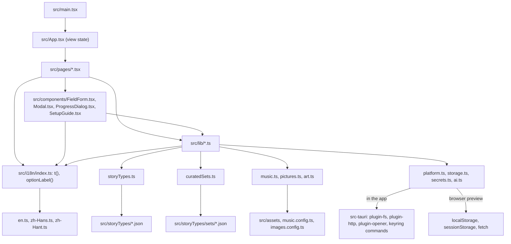

# Architecture

Last checked against the code: 2026-11-01

How the app is put together: the four layers, what each one owns, and the rules between them. What the app does is in [spec.md](../spec.md); why it is built this way is in [decisions.md](../decisions.md).

## The layers

| Layer | Where | Owns |
| --- | --- | --- |
| Tauri shell | [src-tauri/](../../src-tauri/) | The window, the three plugins (file system, HTTP, opener), the API key commands, moving data from the old folder, what the window may do (capabilities and CSP), the installer |
| React UI | [src/main.tsx](../../src/main.tsx), [src/App.tsx](../../src/App.tsx), [src/pages/](../../src/pages/), [src/components/](../../src/components/) | Screens, form state, busy and error states, confirmation dialogs |
| Logic | [src/lib/](../../src/lib/) | Every rule of the spec: files, prompt, AI calls, parsing, limits, tokens, End Chapter, locking, the music player, pictures. No React. |
| Translations | [src/i18n/](../../src/i18n/) | Every text the user reads, in English, 简体中文 and 繁體中文, and the current UI language (spec 11, decision 83). Used by the UI and by `src/lib` errors. |
| Bundled assets and their config | [src/assets/](../../src/assets/), [music.config.ts](../../src/music.config.ts), [images.config.ts](../../src/images.config.ts), [about.config.ts](../../src/about.config.ts) | Backgrounds, figures and music shipped with the app; track credits and levels; picture size and prices; the About page's fixed values |
| Story type config | [src/storyTypes/*.json](../../src/storyTypes/), read through [storyTypes.ts](../../src/lib/storyTypes.ts); curated sets in [src/storyTypes/sets/](../../src/storyTypes/sets/), read through [curatedSets.ts](../../src/lib/curatedSets.ts) | Fields, defaults, rules and prompt fragments of each genre (decisions 6, 27); ready-made worlds, main characters and name pools (decisions 72, 85) |

The Rust side is deliberately small ([lib.rs](../../src-tauri/src/lib.rs)): it registers the plugins, six key commands (`set_api_key`, `get_api_key`, `delete_api_key` and the same for the image key) and a start-up step that moves data from the old folder (decision 154). File storage and AI calls are made from TypeScript through the plugins, not through custom Rust commands. See [platform.md](platform.md).

## Rules between the layers

- **Pages call `src/lib`, never Tauri.** Only four lib modules touch the platform: [platform.ts](../../src/lib/platform.ts), [storage.ts](../../src/lib/storage.ts), [secrets.ts](../../src/lib/secrets.ts) and [ai.ts](../../src/lib/ai.ts). Each loads the Tauri package with a dynamic `import()` only when `isTauri()` is true, so the same code runs in the browser preview and in tests (decision 26).
- **All file access goes through `store`** in [storage.ts](../../src/lib/storage.ts). Paths are relative to the data folder and use forward slashes (`stories/<id>/setting.md`). No module builds absolute paths.
- **Story type JSON is read only through [storyTypes.ts](../../src/lib/storyTypes.ts)** (`getStoryType`, `settingFields`, `characterFields`). The common fields are merged in there, so other code never imports `common.json`. The set files are read only through [curatedSets.ts](../../src/lib/curatedSets.ts) (`getSet`, `randomSet`, `setValues`, …).
- **The logic layer holds the rules.** Pages decide what to show; `src/lib` decides what is allowed. For example the page hides the "next block" form after the concluding block, but [novel.ts](../../src/lib/novel.ts) `writeBlock` also refuses it through `nextBlockBlocked`. When you add a rule, enforce it in `src/lib` and test it there ([testing.md](../testing.md) section 1).
- **Files are the state.** Pages reload from disk after every change (for example `Novel.refresh` in [NovelTab.tsx](../../src/pages/NovelTab.tsx) calls `loadNovelState`). The only state kept outside files is the unsent direction and hint ([unsent.ts](../../src/lib/unsent.ts), decision 59), the music player's state, whether a picture is drawing or failed ([pictures.ts](../../src/lib/pictures.ts)), and the API keys in the browser preview.
- **The AI sits behind [ai.ts](../../src/lib/ai.ts).** Pages and other modules see `streamChat`, `listModels` and `generateImage` only, so another provider format would change one file (spec 2).
- **Extras never block writing.** The music player and picture drawing are called after a block or chapter is saved and are never awaited; a failure in either stays inside it ([music-and-pictures.md](music-and-pictures.md)).
- **Every text the user reads comes from `t()`** in [src/i18n/index.ts](../../src/i18n/index.ts), including the errors `src/lib` throws (decision 83). Story type labels, hints, options and section names are read through `fieldLabel`, `fieldHint`, `optionLabel`, `sectionName` and `typeName`, never from the JSON directly. The story's own content, the provider's words in an error and the AI call log are not translated (spec 11).
- **Three languages, kept apart.** The UI language (`uiLanguage` in `app-settings.json`) only changes what `t()` returns. The novel's language (`language` in `setting.md` and `story.json`) decides which text of the curated set is used and in which language choice values are sent to the AI (`novelLocale`). Files always hold choice values in English (spec 3, decision 84).

## Navigation

There is no router (decision 25). [App.tsx](../../src/App.tsx) keeps a `View` in state: `stories`, `story` (with an id), `settings` or `about`. On start it loads `app-settings.json`, calls `setLocale(uiLanguage)`, applies the theme and font size, passes the music settings to the player, reads the key, and opens Settings with the first-run guide when there is no key and no story. Until the file has a valid `uiLanguage`, `loadSettings` takes it from `detectLocale()` (the system languages, spec 11).

**Switching the UI language** goes through `App.updateSettings`: it calls `setLocale` before `setSettings`, so the re-render that follows reads the new language everywhere. Nothing is remounted, so unsaved form edits stay. `t()` reads a module-level variable, not React context; a component that does not re-render keeps its old texts until it does.

Leaving an open story can be stopped by a **leave guard**. [StoryWorkspace.tsx](../../src/pages/StoryWorkspace.tsx) registers a guard with `registerLeaveGuard` while the Setting tab has unsaved edits, a block is being written, or the End Chapter call runs (decision 77); `App.navigate` (the top navigation bar) and the workspace's own back button call it before changing the view. The question is one `Modal` with three texts (spec 9, decisions 59 and 77); leaving aborts the running AI call.

## The story workspace

[StoryWorkspace.tsx](../../src/pages/StoryWorkspace.tsx) holds three tabs: Novel, Characters, Setting. **All three stay mounted**; the hidden ones only get the `hidden` attribute. That keeps unsaved edits when switching tabs, and it is why E2E tests scope to the visible `tabpanel` (see [testing-internals.md](testing-internals.md)).

The tabs talk through the workspace, not to each other:

| Signal | From | To | Why |
| --- | --- | --- | --- |
| `draftVersion` | Novel (`onDraftChanged`) | Setting | Re-check `isSettingLocked` after the draft file changed (spec 8.1) |
| `writing` | Novel (`onWritingChange`) | Setting, leave guard | A block in progress locks the setting before the draft has blocks (decision 61) and makes leaving ask first |
| `summarizing` | Novel (`onSummarizingChange`) | Leave guard | The End Chapter call is running; leaving asks first and aborts it (decision 77) |
| `settingVersion` | Setting (`onSaved`) | Characters | Re-read the rank ladder |
| `onStoryChanged` / `setStory` | Novel, Setting | Workspace header, all tabs | `story.json` changed (chapter count, status, language) |
| `refreshReadiness` | Setting, Characters | Novel | Unlock the Novel page once `setting.md` and a main character exist (spec 4) |

## The Novel page

[NovelTab.tsx](../../src/pages/NovelTab.tsx) shows a checklist until `getReadiness` reports a setting and a main character. After that, `Novel` asks [endChapter.ts](../../src/lib/endChapter.ts) `loadNovelState` where the story stands and renders one of four states:

| `NovelState.kind` | When | Rendered by |
| --- | --- | --- |
| `writing` | No draft blocks, an epilogue draft, or a draft whose chapter has no `chapter.md` yet | `ChapterWriter` (start screen, blocks, regenerate, death pause, action bar) |
| `summary-pending` | `chapter.md` exists but its `summary.md` does not (End Chapter call failed) | Retry panel calling `summarizeChapter` |
| `review` | `chapter.md` and `summary.md` exist and the draft is still there | [ChapterReview.tsx](../../src/pages/ChapterReview.tsx) |
| `completed` | `story.status === "completed"` | Read-only notice; the chapter list stays |

`ChapterWriter` is keyed by chapter number and epilogue flag, so it starts fresh for every chapter. The flow of a block is in [ai-pipeline.md](ai-pipeline.md); the files behind each state are in [data-and-storage.md](data-and-storage.md).

**Busy states (decision 88).** While a block is written, `ChapterWriter` shows "Writing…", a spinner and Stop in its bottom action bar. End Chapter, the summary retry, End story and accepting the epilogue run through `Novel.run`, which shows [ProgressDialog.tsx](../../src/components/ProgressDialog.tsx): a dialog that cannot be closed, with a title, the current step and, only while the AI call runs, Stop. `Novel.runSummary` maps each `EndChapterStep` (`saving-chapter`, `writing-summary`, `saving-summary`) that `endChapter` and `summarizeChapter` report through `onStep` to a text (`STEP_TEXT`). Stop aborts the same controller that leaving the story aborts (decision 77); a stopped call leaves the chapter in `summary-pending`. When the Novel page opens while an earlier End Chapter call is still running (`summaryInFlight`), it shows the dialog without Stop and waits for it.

**Reading a chapter.** Clicking a chapter in the list sets `reading`; `ChapterReader` shows it with links to the previous and next chapter above and below the text, and "back to the current chapter" after the last one unless the story is completed (spec 5.6). It also shows the chapter's tokens from its `summary.md`.

## Invariants and gotchas

- **Do not import Tauri packages statically.** A top-level `import "@tauri-apps/..."` would load in the browser preview and in Vitest, where there is no Tauri. Keep the dynamic `import()` behind `isTauri()`.
- **`store` is chosen once, at module load** (`isTauri() ? new TauriStore() : new BrowserStore()`). Tests rely on jsdom having no `__TAURI_INTERNALS__`.
- **The draft file drives the Novel page.** `loadNovelState` decides between writing, summary pending and review from `draft/draft.json` plus the chapter files, not from `story.json`. `chapterCount` is already raised at End Chapter step 1, before the review, and `reconcileStory` repairs it from the files if that write failed (decision 75); the draft is what keeps the review open until `finishChapter` deletes it (decision 50).
- **The setting lock has two sources:** `isSettingLocked` (the draft has blocks) and the `writing` prop (a first block is arriving). Changing either alone breaks decision 61.
- **Tabs stay mounted**, so ids must be unique per form instance ([FieldForm.tsx](../../src/components/FieldForm.tsx) prefixes them with `useId`; E2E-26 checks this).
- **The version number** is set in [package.json](../../package.json); [tauri.conf.json](../../src-tauri/tauri.conf.json) reads it from there (`"version": "../package.json"`) and the About page gets it from the build (`__APP_VERSION__`, defined in [vite.config.ts](../../vite.config.ts)). [Cargo.toml](../../src-tauri/Cargo.toml) has its own crate version; keep it the same.
- **Call `t()` when the text is needed, not at module load.** A constant built with `t()` at import time is frozen in English. [ai.ts](../../src/lib/ai.ts) keeps its messages as functions (`NO_CONNECTION = () => t(...)`) for this reason.
- **Set the locale before the re-render.** `t()` has no subscription of its own; pages show the new language only because `App.updateSettings` calls `setLocale` and then changes React state. Another place that changes `uiLanguage` must do the same.
- **Some English strings are stored and translated on display.** The epilogue's title is saved as `"Epilogue"` and an untitled chapter as `defaultTitle(n)` (`"Chapter N"`); `chapterTitle` in [NovelTab.tsx](../../src/pages/NovelTab.tsx) maps both to the UI language. Change those strings in [chapters.ts](../../src/lib/chapters.ts) or [endChapter.ts](../../src/lib/endChapter.ts) and old chapters show raw English titles.
