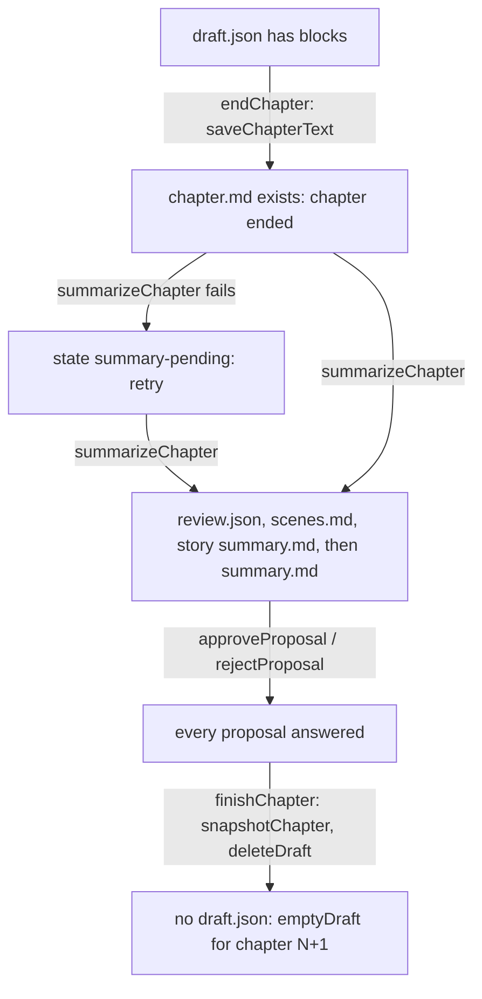

# Data and storage

Last checked against the code: 2026-11-01

Where the app keeps its data, the format of each file, which code writes it and when. The layout the spec asks for is in [spec.md](../spec.md) section 3; this page is what the code does.

## The data folder

Every path in the code is relative to one root and uses forward slashes. [storage.ts](../../src/lib/storage.ts) maps it:

| Where | Root | How |
| --- | --- | --- |
| The app (`npm run tauri dev`, installer) | `ainovelgenerator` (`DATA_FOLDER`) under Tauri's `BaseDirectory.Data`: `%APPDATA%\ainovelgenerator` on Windows, `~/.local/share/ainovelgenerator` on Linux (decision 154) | `TauriStore`, through `@tauri-apps/plugin-fs` |
| Browser preview (`npm run dev`), Vitest | None | `BrowserStore`: one localStorage entry per file, key `ang-file:<path>` |

`store.rootPath()` gives the absolute folder in the app and `null` in the browser; Settings uses it for "Open data folder".

Builds before 2026-11-01 used the folder named after the bundle identifier (`%APPDATA%\com.jckek.ainovelgenerator`). On start the Rust side moves `app-settings.json` and `stories/` from there when the new folder has neither ([platform.md](platform.md#the-rust-side)).

## Layout

```
app-settings.json                     settings.ts
stories/<story-id>/
  story.json                          stories.ts
  setting.md                          setting.ts
  notes.md                            setting.ts
  summary.md                          chapters.ts  (the "story so far")
  scenes.md                           chapters.ts  (used scenes, spec 6.4)
  characters/<character-id>.md        characters.ts
  draft/draft.json                    draft.ts
  draft/pictures/<versionKey>.webp    pictures.ts  (Rich, one per block version)
  chapters/001/chapter.md             chapters.ts
  chapters/001/summary.md             chapters.ts
  chapters/001/review.json            endChapter.ts
  chapters/001/snapshot/setting.md    chapters.ts snapshotChapter
  chapters/001/snapshot/characters/*.md
  chapters/001/picture.webp           pictures.ts  (Lite)
  chapters/001/pictures/NNN.webp      pictures.ts  (Rich, the chosen versions, by block number)
  chapters/001/pictures.json          pictures.ts  (where each Rich picture goes)
  ai-log/<time>-<kind>-<outcome>.md   devlog.ts (development builds only)
```

Ids are made by `makeId` in [stories.ts](../../src/lib/stories.ts): a lower-case slug of the title (or character name) cut to 32 characters, plus `-` and 6 random characters. A title with no Latin letters gives `story-<suffix>` (`character-<suffix>` for characters). The id is fixed at creation; renaming does not change the folder or file name.

Chapter folders are the number padded to three digits (`chapterDir`). `listChapters` reads them with `Number(name)`, so a chapter 1000 folder would still be found.

## File formats

### Markdown with a YAML header

`setting.md` and character files use [markdoc.ts](../../src/lib/markdoc.ts) (decisions 5, 28):

```
---
name: Lin Feng
main_character: true
age: 19
personality_traits: [stubborn, loyal]
---

Background text.
```

- `formatMarkDoc` writes lists of plain values whose items join to 60 characters or fewer on one line (`[a, b]`), longer ones as a block (decision 29). Long text is never folded (`lineWidth: 0`).
- `parseMarkDoc` accepts a byte-order mark and CRLF, needs the closing `---` on its own line, and throws a readable error for invalid YAML or a header that is not a map. A file without a header is all body.
- Header keys are the field keys of the story type ([story-types.md](story-types.md)). `valuesFromHeader` turns the header into form values with `coerce` and keeps unknown keys in `extra`; `headerFromValues` writes the fields in field order, then `extra`. So keys added by hand survive a save.

| File | Header | Body | Written by |
| --- | --- | --- | --- |
| `setting.md` | `settingFields` order (common, then the type's), then `extra` | World background | `saveSetting`, which also copies the language into `story.json` (decision 31) |
| `characters/<id>.md` | `name`, `main_character`, then the other `characterFields` in order, minus fields hidden for the main character, then `extra` | Background | `saveCharacter`; `approveProposal` for approved changes and accepted new characters |
| `chapters/NNN/summary.md` | `title`; `openings` (a list) only when there are some; `tokens` (`{ input, output }`, plus `estimated: true` when any part was estimated) when known (spec 6.6) | The AI's chapter summary; empty for the epilogue | `saveChapterSummary` via `summarizeChapter`, `renameChapter` (keeps the tokens), `acceptEpilogue` |

Choice values (`tone`, `gender`, `trope`, …) are always written in English in these headers, whatever the UI or novel language (spec 3, decision 84). The translations exist only on screen and in the prompt.

### Plain markdown

| File | Format | Written by |
| --- | --- | --- |
| `notes.md` | One `- ` line per note | `saveNotes`. `loadNotes` also accepts `*` bullets and drops blank lines. |
| `summary.md` (story) | Free text, trimmed, one trailing newline | `saveStorySummary` |
| `scenes.md` | One `- ` line per used scene | `saveUsedScenes`. `readUsedScenes` accepts `-` or `*` bullets; a missing file is an empty list. |
| `chapters/NNN/chapter.md` | The chosen text of each block, joined by a blank line | `saveChapterText`, once |
| `ai-log/*.md` | See [ai-pipeline.md](ai-pipeline.md#the-ai-call-log) | `writeAiLog` |

### JSON

All JSON is written with two-space indents (`writeJson`, `saveDraft`).

| File | Shape (TypeScript type) | Written by |
| --- | --- | --- |
| `app-settings.json` | `AppSettings` in [settings.ts](../../src/lib/settings.ts): `baseUrl`, `model`, `contextBudget`, `fontSize`, `theme`, `uiLanguage` (`en`, `zh-Hans` or `zh-Hant`, spec 11), `backgroundArt`, `music`, `musicVolume` (0–100), `images` (`none` / `lite` / `rich`), `imageBaseUrl`, `imageModel`, `imageQuality` (`low` / `medium`), `imageSameAsText`. No key. | `saveSettings` on every change in Settings |
| `story.json` | `Story` in [stories.ts](../../src/lib/stories.ts): `id`, `title`, `type`, `language`, `status` (`active` / `completed`), `chapterCount`, optional `ending` (`death` / `choice`), optional `setId` (the curated set, decision 85), optional `openedAt` (the bookshelf order, decisions 109, 115), `createdAt`, `updatedAt` | `createStory`, `updateStory` |
| `draft/draft.json` | `Draft` in [draft.ts](../../src/lib/draft.ts): `chapter`, `blocks[]` (each `direction`, `versions[]`, `chosen`), optional `epilogue: true`, optional `ending` (the ending accepted at End Chapter, kept until the draft is deleted, decision 75), optional `tokens` (every successful block call of the chapter, spec 6.6). A version is `BlockVersion`: `text`, `actions`, optional `notes` (one per action, `""` where the AI gave none, decision 86), `died`, `hint`, `createdAt`, optional `tokens`, optional `mood` (spec 13), optional `picture` (the Rich scene line, spec 14.2). | `saveDraft` from `writeBlock` and from the page's version switch |
| `chapters/NNN/pictures.json` | `{ blocks: [{ file, afterParagraph }] }`: each Rich picture and the paragraph of `chapter.md` (counted from 1) it follows | `keepChapterPictures` |
| `chapters/NNN/review.json` | `Review` in [endChapter.ts](../../src/lib/endChapter.ts): `chapter`, `proposals[]`, each a `ChangeProposal` or `NewCharacterProposal` with `status` `pending` / `approved` / `rejected` | `summarizeChapter`, then each answer |

`loadSettings` merges the file over `DEFAULT_SETTINGS` with `uiLanguage` from `detectLocale()`, so older files load and a missing or unknown `uiLanguage` follows the system language; a corrupt file gives those defaults. `loadDraft` tidies a hand-edited draft (`normalizeDraft`: drops versions without text, fixes `chosen`, keeps `notes` only as one string per action, keeps `tokens` only when `readTokens` accepts them, falls back to `chapterCount + 1`) and throws a plain-words error for a draft that is not JSON.

**`setId` and the setting.** `createStory` saves a random set's id (or the one passed, as the test fixtures do). `loadSetting` uses it to fill a setting that has no `setting.md` yet, so the same world shows on every visit until the first save (decision 85). `SettingDoc.setId` carries the set shown, which Randomize changes; `saveSetting` writes it to `story.json` with the language. A story without `setId` uses the type's first set (`getSet`).

`updateStory` bumps `updatedAt` on every call (`writeBlock`, `saveCharacter`, `deleteCharacter`, `saveSetting`, `finishChapter`). The bookshelf order is the last opening instead: `markOpened` sets `openedAt` when a story is entered, and `listStories` sorts by `openedAt`, newest first, falling back to `updatedAt` for stories from before phase 7.

## When files are written

| User action | Files written | Code |
| --- | --- | --- |
| New story | `story.json` (with `setId` and `openedAt`) | `createStory` |
| Open a story | `story.json` (`openedAt`) | `markOpened` from [StoryWorkspace.tsx](../../src/pages/StoryWorkspace.tsx) |
| Save setting | `setting.md`, `story.json` (`language`, and `setId` when the doc has one) | `saveSetting` |
| Randomize, change the novel's language on the Setting page | Nothing until the setting is saved | `applySet`, `switchSetLanguage` in [SettingTab.tsx](../../src/pages/SettingTab.tsx) |
| Change the UI language | `app-settings.json` only; no story file | `App.updateSettings` → `saveSettings` |
| Save notes | `notes.md` (any time, also while the setting is locked, decision 30) | `saveNotes` |
| Save or delete a character | `characters/<id>.md`, `story.json` | `saveCharacter`, `deleteCharacter` |
| A block arrives in full | `draft/draft.json`, `story.json`, an `ai-log/` file in development | `writeBlock` |
| A block fails or is stopped | Only an `ai-log/` file in development | `loggedCall` |
| Switch block version | `draft/draft.json` | `chooseVersion` + `saveDraft` in [NovelTab.tsx](../../src/pages/NovelTab.tsx) |
| End Chapter, step 1 | `draft/draft.json` (only when the ending changes), `chapters/NNN/chapter.md`, `story.json` (`chapterCount`, and `ending` for an accepted death) | `endChapter` |
| Novel page loads, `finishChapter` | `story.json`, only when `chapterCount` or `ending` is behind the chapter files (decision 75) | `reconcileStory` |
| End Chapter call answers | in this order: `chapters/NNN/review.json`, `scenes.md` (only if the answer has scenes), story `summary.md`, and last `chapters/NNN/summary.md` with the chapter's tokens, the step's marker (decision 76) | `summarizeChapter` |
| Edit the chapter title | `chapters/NNN/summary.md`, 400 ms after typing stops and on blur (decision 60) | `renameChapter` from [ChapterReview.tsx](../../src/pages/ChapterReview.tsx) |
| Approve or reject a proposal | `review.json`, and the character file on approve; an answered proposal, or a new character whose name now exists, writes nothing (decision 78) | `approveProposal`, `rejectProposal`, `markAccepted` |
| Finish chapter | `chapters/NNN/pictures/` and `pictures.json` (Rich), `chapters/NNN/snapshot/`, deletes `draft/`, `story.json` | `finishChapter` (`keepChapterPictures`) |
| End story | `story.json` (`ending: "choice"`) | `endStory` |
| A Rich block saved, or Make picture | `draft/pictures/<versionKey>.webp` when the picture arrives; an `ai-log/` file in development | `drawBlockPicture` (never awaited) |
| End Chapter answer saved, on Lite | `chapters/NNN/picture.webp` when it arrives | `drawChapterPicture` |
| Accept the epilogue | `chapters/NNN/chapter.md`, `summary.md` (title "Epilogue", the draft's tokens), `snapshot/`, deletes `draft/`, `story.json` (`status: "completed"`) | `acceptEpilogue` |

## End Chapter in files

End Chapter keeps its progress in files so the app can close at any step (decision 50). `loadNovelState` reads the same files back.



The setting stays locked through the whole review, because `isSettingLocked` only checks that `draft.json` has blocks (spec 8.1).

## Snapshots

`snapshotChapter` removes `chapters/NNN/snapshot/` and copies `setting.md` and every `characters/*.md` into it. It runs in `finishChapter` (after the approved changes are written) and in `acceptEpilogue`. Nothing reads the snapshots yet; they are kept for a later rewind (decision 19).

## The API keys

Never in a file (decision 3). The text AI's key and the image provider's key are kept apart (spec 14.1).

| Where | Store | Key |
| --- | --- | --- |
| The app | OS credential store through the `keyring` crate in [lib.rs](../../src-tauri/src/lib.rs) (Windows Credential Manager, or the Secret Service on Linux) | Service `ai-novel-generator`, accounts `api-key` and `image-api-key` |
| Browser preview, Vitest | sessionStorage | `ang-dev-api-key` and `ang-dev-image-key` (gone when the tab closes) |

## The browser preview store

`BrowserStore` has no real folders. Binary files (pictures) are stored as base64 text (`readBytes`, `writeBytes`). A folder "exists" when any key starts with `<path>/`, and `list` derives children from the keys. `remove` deletes the key and every key under it. Reading a missing file throws `File not found: <path>`, which `errorText` turns into plain words.

localStorage has a size limit set by the browser. Every story, and in development every AI log file, counts against it; a full store raises `QuotaExceededError`, which `errorText` explains.

## Invariants and gotchas

- **`chapter.md` is written once.** `saveChapterText` refuses to overwrite, and its existence is what "ended" means (`chapterEnded`). `endChapter` and `acceptEpilogue` skip the write when it already exists.
- **`story.json` follows the chapter files, not the other way round** (decision 75). `endChapter` saves an accepted ending into `draft.json`, then writes `chapter.md`, then raises `chapterCount`. If that last write fails, `reconcileStory` repairs `chapterCount` and `ending` from the draft and `chapter.md`; the Novel page runs it on every load, and `finishChapter` runs it before deleting the draft. So the retry the page offers (`summarizeChapter`) is safe after a crash at any point of step 1.
- **The marker file is written last.** In `summarizeChapter` the chapter's `summary.md` goes after `review.json`, `scenes.md` and the story summary, so a failed write leaves "summary pending" and Retry redoes the step (decision 76). Keep this rule for any new sequence of writes.
- **The draft changes only when a block has arrived in full** (decision 38). The one other write is the version switch.
- **Old flag lines are cleaned on read, not rewritten.** `normalizeDraft` and `readChapterText` call `stripFlagLines` (decision 54); `chapter.md` keeps the line on disk.
- **Unknown header keys are kept.** Do not build headers by hand; use `headerFromValues` with the doc's `extra`.
- **`scenes.md` is only replaced by a non-empty list.** An End Chapter answer without `scenes` keeps the old file (spec 6.4).
- **The story summary has no hard cap in code.** The End Chapter call is asked to stay under the budget's cap and to compress when over it; the prompt then sends the summary in full. The used scenes list, by contrast, is cut to the newest lines that fit (`newestWithin` in [prompt.ts](../../src/lib/prompt.ts)).
- **Writes are plain overwrites.** There is no temporary file and rename. Not clear from the code what a crash in the middle of `writeTextFile` leaves behind.
- **Deleting the draft by hand during a review** skips that review: `loadNovelState` then sees an empty draft for chapter N+1, because `chapterCount` was already raised at step 1.
- **Stories begun before a rule** keep working: no `scenes.md` means an empty list; a `summary.md` without `openings` means no openings; no `setId` means the type's first set; a block version without `notes` or `tokens`, or a chapter `summary.md` without `tokens`, simply shows none; a `language` outside the three (from before phase 6) stays selectable and gets English set text and choice values.
- **Choice values on disk are English.** Never save what `optionLabel` or `localizeChoices` returns; a Chinese value in a file loads as it is, then fails `validate` (not one of the options) the next time the form is saved, and prompt lookups such as `POINT_OF_VIEW` fall back to their default.
- **Some titles are stored in English and translated on display.** `"Epilogue"` and `defaultTitle(n)` (`"Chapter N"`) are written to `summary.md` as they are; `chapterTitle` in [NovelTab.tsx](../../src/pages/NovelTab.tsx) shows them in the UI language.
- **The chapter's token total lives in the draft until End Chapter.** `runSummary` reads `Draft.tokens` only when the draft is for the same chapter; if the draft was deleted by hand before the call, the saved total is the End Chapter call alone.
