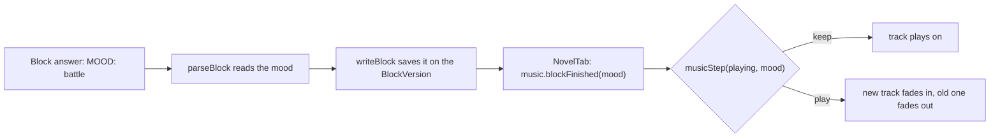
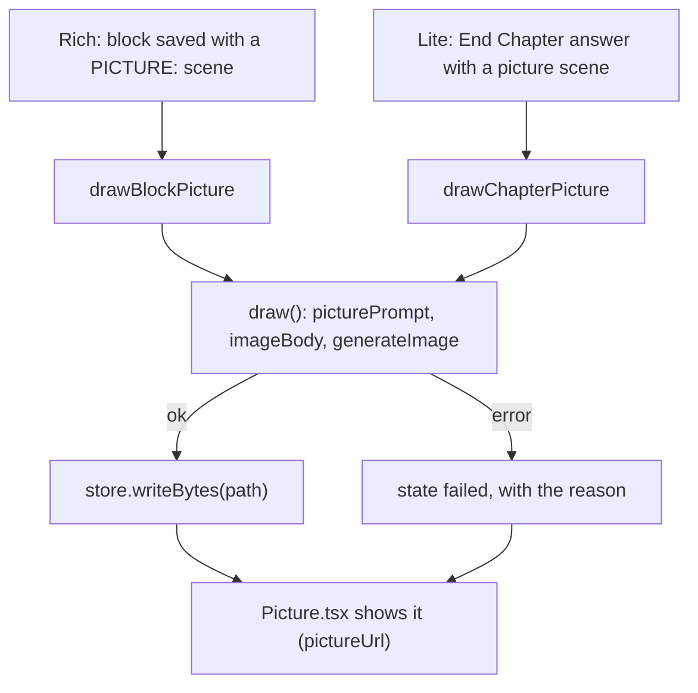

# Music and pictures

Last checked against the code: 2026-11-01

How the phase 8 extras are wired: background music at the story's peaks (spec 13) and pictures of the story (spec 14). Both hang off the same block answer as the story text: the AI adds a `MOOD:` line, and on Rich a `PICTURE:` line, after the `=== NEXT ===` marker ([ai-pipeline.md](ai-pipeline.md#6-parsing)). Neither may ever block or change writing.

## Files

| File | Holds |
| --- | --- |
| [mood.ts](../../src/lib/mood.ts) | `MOODS` (six), `MOOD_MEANINGS` (the words the prompt uses), `isMood`, `readMood` (anything unknown, and `none`, is no mood) |
| [music.ts](../../src/lib/music.ts) | The one Web Audio player (`music`), `FADE` lengths, `musicStep`, `dbToGain`, `trackUrl` |
| [music.config.ts](../../src/music.config.ts) | One track per mood: file, title, artist, licence, source and level in dB (decisions 133–135) |
| [src/assets/music/](../../src/assets/music/) | `<mood>.mp3`, 128 kbps; `npm run encode-music -- <files>` converts new ones (decision 136) |
| [pictures.ts](../../src/lib/pictures.ts) | The picture prompt, prices, the image config, drawing in the background with its state, where picture files live, keeping them at End Chapter, showing them |
| [images.config.ts](../../src/images.config.ts) | `PICTURE_SIZE` (1536x1024), the format (WebP), prices per model and quality (decision 142) |
| [ai.ts](../../src/lib/ai.ts) `imageBody`, `generateImage`, `PictureRefused` | The `POST <base>/images/generations` request and its errors |
| [Picture.tsx](../../src/components/Picture.tsx) | One picture place on a page, and `useImageLevel` |
| [secrets.ts](../../src/lib/secrets.ts) `getImageKey` … | The image key, under its own credential account (`image-api-key`) |

## Music

**Prompt.** `MOOD_RULE` in [prompt.ts](../../src/lib/prompt.ts) lists the moods with `MOOD_MEANINGS`, says what is not a peak, and asks for `MOOD: none` on most blocks (decision 139). It is asked for in every type, General included. The epilogue gets its own short rule: `triumphant`, `sad` or `none`.

**Parsing and saving.** `parseBlock` reads `MOOD_LINE` anywhere after the marker (and as a bare line without one), never shows it, and keeps `mood` only for a known mood. `writeBlock` copies it to `BlockVersion.mood`; `normalizeDraft` keeps it only when `readMood` accepts it.

**The player.** `music` in [music.ts](../../src/lib/music.ts) is one object for the whole app, so a track survives tab changes inside a story. Each track has its own `GainNode`, which carries both the fades and the track's level (a gain above 1 for a quiet track).

| Call | From | Does |
| --- | --- | --- |
| `configure(on, volume)` | [App.tsx](../../src/App.tsx), on every settings change | Off fades out in 0.2 s; volume applies at once to a playing or paused track |
| `setHidden(hidden)` | `onWindowHidden` in [platform.ts](../../src/lib/platform.ts) via App.tsx | Pauses when the window is minimised or hidden, resumes when shown |
| `enterStory(id)` / `leaveStory()` | [StoryWorkspace.tsx](../../src/pages/StoryWorkspace.tsx) mount and unmount | Same story: resume (3 s fade). Another story: start silent (decision 132) |
| `blockFinished(mood)` | `ChapterWriter` in [NovelTab.tsx](../../src/pages/NovelTab.tsx), with the chosen version's mood after a block or regenerate is saved | `musicStep`: `keep` for no mood or the same mood still playing, `play` otherwise (crossfade 5 s) |
| `endChapter()` | NovelTab, on End Chapter and End story | Fades out over 5 s; the next chapter starts silent |

A track plays once: it fades in over 6 s, and its closing fade (10 s) starts that long before its end (decision 149). The state is mirrored on `<html data-music>` as `"<mood> playing"`, `"<mood> paused"` or `""` for the E2E tests. Where there is no `AudioContext` (Vitest), the player does nothing.

## Pictures

**Levels** (`AppSettings.images`): `none` sends nothing; `lite` adds a `picture` key to the End Chapter JSON (`buildEndChapterPrompt` with `picture: true`); `rich` adds `PICTURE_RULE` to the block prompt (`buildPrompt` with `pictures: true`). The scene is always English, and goes in the AI log's facts.

**The request.** `draw` in [pictures.ts](../../src/lib/pictures.ts) reads the settings and key (`loadImageConfig`: the image provider's own base URL and key, or the text AI's when `imageSameAsText` is on), lists the story's characters, and builds `picturePrompt(type.imageStyle, scene, characters)`: the style, the scene, the `appearance` of every character the scene names (matched with `mentions`, like characters in the scene), and "no text or lettering". `imageBody` is `{ model, prompt, n: 1, size, quality, output_format }`. `generateImage` accepts `b64_json` or a `url` in `data[0]`; a 400 whose code or message speaks of moderation or safety throws `PictureRefused`. Errors use the same plain words as text calls.

**State, never in files.** `pictureState(path)` is `drawing`, `failed` (with the reason) or nothing; `subscribePictures` feeds `useSyncExternalStore` in [Picture.tsx](../../src/components/Picture.tsx). A second `draw` for a path already drawing is ignored. `draw` never throws, so a caller can fire and forget it, and it keeps running after the story is left.

**Where the files go** (decision 146):

| Picture | While writing | After the chapter is finished |
| --- | --- | --- |
| Rich, one per block version | `draft/pictures/<versionKey>.webp`, the key being the version's `createdAt` in digits | `keepChapterPictures` copies the chosen versions' files to `chapters/NNN/pictures/<block>.webp` and writes `pictures.json` (each file and the paragraph of `chapter.md` it follows); `draft/pictures/` goes with the draft |
| Lite, one per chapter | | `chapters/NNN/picture.webp`, drawn after the End Chapter answer is saved |

`readChapterPictures` gives the reader both; a broken `pictures.json` only loses the pictures. `pictureUrl` reads the bytes, sniffs the real type from the first bytes (providers may ignore the format asked for) and caches a `blob:` URL.

**No scene, no error.** A Rich block without a `PICTURE:` line, or a Lite chapter without a scene, shows "Make picture", which uses the last `SCENE_FROM_TEXT_CHARS` (600) characters of the block, or the chapter summary.

**Cost.** `pictureCost(model, quality)` reads [images.config.ts](../../src/images.config.ts); `costText` is the line in Settings (per picture, per chapter for Lite and Rich). A model not in the table says the price is not known.

## Invariants and gotchas

- **The mood and picture lines are part of the block format contract** with `parseBlock`, `visibleText` and the mock server ([testing-internals.md](testing-internals.md)). The mock adds a picture line only when the system message contains `Then the picture line`.
- **Writing never waits for a picture.** Keep `draw` calls un-awaited in the pages and in `summarizeChapter`.
- **A version's picture is found by `createdAt`.** Changing how `createdAt` is written changes `versionKey` and orphans pictures of old drafts.
- **Turning images down keeps what exists.** Only new requests stop; pages still show saved files.
- **The picture is never sent back to the text AI**, and its bytes and the key are never written to the AI log.
- **Music starts only after a click** (Write), which keeps the webview's autoplay rule happy; no music starts on opening a story or reading a chapter.
- **Two places pause music.** Leaving the story (`leaveStory`) and hiding the window (`setHidden`); resuming needs both the same story open and the window shown.
- **The CSP allows `media-src 'self' blob:` and `img-src 'self' blob: data:`** for the bundled tracks and the picture URLs ([platform.md](platform.md#build-and-configuration)). A new kind of media needs a matching rule.
