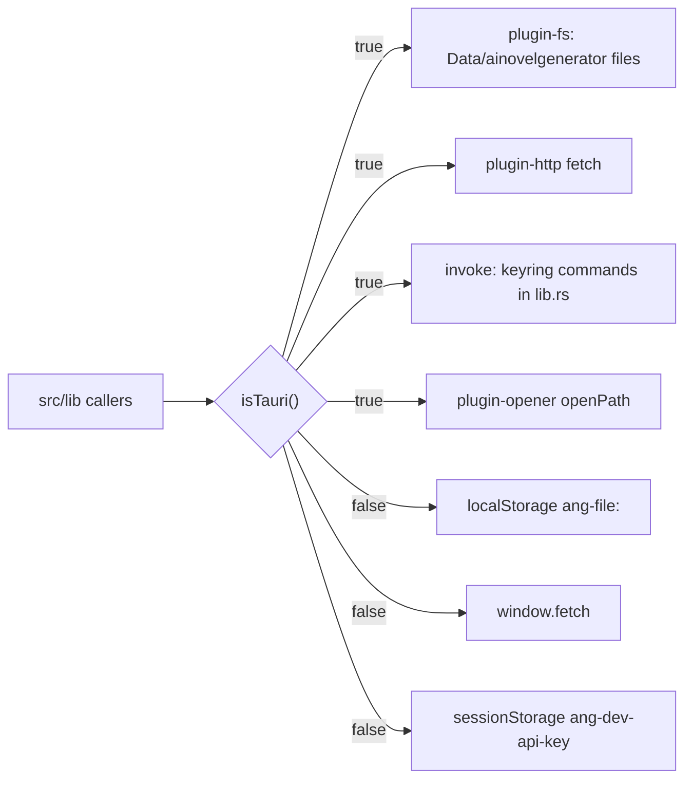

# Platform: Tauri and the browser preview

Last checked against the code: 2026-11-01

The same React and `src/lib` code runs in three places: the Tauri app, the browser preview (`npm run dev`) and the tests. This page says where they differ and what only the real app exercises. Why the split exists: decision 26.

## Detecting the platform

[platform.ts](../../src/lib/platform.ts) `isTauri()` is true when `window.__TAURI_INTERNALS__` exists. Tauri injects it into its webview; a normal browser and jsdom (Vitest) do not have it.

Four modules branch on it. Each loads the Tauri package with a dynamic `import()` inside the Tauri branch, so the browser never loads it.

| Module | In the app | In the browser preview and tests |
| --- | --- | --- |
| [storage.ts](../../src/lib/storage.ts) | `TauriStore`: `@tauri-apps/plugin-fs` with `baseDir: Data` and every path under `ainovelgenerator/` (`DATA_FOLDER`, decision 154); `writeText` and `writeBytes` make the parent folder first | `BrowserStore`: localStorage keys `ang-file:<path>` |
| [secrets.ts](../../src/lib/secrets.ts) | `invoke("get_api_key" / "set_api_key" / "delete_api_key")`, and the same three for the image key (`get_image_key` …) | sessionStorage `ang-dev-api-key` and `ang-dev-image-key` |
| [ai.ts](../../src/lib/ai.ts) `httpFetch` | `fetch` from `@tauri-apps/plugin-http` (runs in Rust: no CORS, streams, honours the abort signal); also used for picture requests | the browser's `fetch` |
| [platform.ts](../../src/lib/platform.ts) `openFolder`, `openLink` | `openPath` / `openUrl` from `@tauri-apps/plugin-opener` | `openFolder` does nothing; `openLink` uses `window.open` |
| [platform.ts](../../src/lib/platform.ts) `onWindowHidden` | `visibilitychange`, plus the window's resize events and `isMinimized` (a minimised webview does not always report hidden) | `visibilitychange` only |

The UI checks `isTauri()` in one place: the key hint in [Settings.tsx](../../src/pages/Settings.tsx). The "Your data" panel switches on `store.rootPath()` being `null`.

## The Rust side

[src-tauri/src/lib.rs](../../src-tauri/src/lib.rs) `run()` registers `tauri_plugin_fs`, `tauri_plugin_http` and `tauri_plugin_opener`, a `setup` hook that moves old data (below), and six commands on a `keyring::Entry` with service `ai-novel-generator`: three for the text key (account `api-key`) and three for the image key (account `image-api-key`, spec 14.1):

| Command | Returns | No entry |
| --- | --- | --- |
| `set_api_key(key)`, `set_image_key(key)` | `()` | |
| `get_api_key()`, `get_image_key()` | `Option<String>` | `None` |
| `delete_api_key()`, `delete_image_key()` | `()` | treated as success |

Errors come back to TypeScript as strings.

**Moving the old data folder (decision 154).** Builds before 2026-11-01 kept data in `app_data_dir()`, the folder named after the bundle identifier. `move_old_data` runs in `setup`, before the window loads: when the new folder (`data_dir()/ainovelgenerator`) has neither `app-settings.json` nor `stories/` and the old one has either, it renames both across, then removes the old folder only if it is empty (on Linux it also holds the webview's data, so it stays). A failure is printed to stderr and the app starts with an empty folder; nothing is ever written over. It runs in Rust so the window needs no access to the old folder. Three `cargo test` cases in `lib.rs` cover it.

 [main.rs](../../src-tauri/src/main.rs) only calls `run()` and hides the console window in release builds. [Cargo.toml](../../src-tauri/Cargo.toml) picks the keyring backend per OS (Windows native, Apple native, Linux secret service).

## Capabilities

[capabilities/default.json](../../src-tauri/capabilities/default.json) applies to the window labelled `main` (the one window in [tauri.conf.json](../../src-tauri/tauri.conf.json), which gets the default label).

| Permission | Allows |
| --- | --- |
| `core:default` | Tauri core, including `invoke` of the app's own commands |
| `fs:allow-exists`, `-mkdir`, `-read-dir`, `-read-file`, `-read-text-file`, `-write-file`, `-write-text-file`, `-remove` | Only the fs commands `TauriStore` uses (decision 154) |
| `fs:scope` with `$DATA/ainovelgenerator` and `$DATA/ainovelgenerator/**` | Those commands work in the data folder and nowhere else |
| `http:default` with `https://**`, `https://*:*`, `http://**`, `http://*:*` | Requests to any URL, because the base URL is a user setting (decision 2) and local models use plain `http` |
| `opener:default` (links in the default browser), `opener:allow-open-path` for `$DATA/ainovelgenerator` only | Opening the data folder itself in the file explorer, never a file in it (decisions 151, 154) |

A new plugin call that is not covered here fails only in the real app, with a permission error.

## Build and configuration

[tauri.conf.json](../../src-tauri/tauri.conf.json):

- `build.beforeDevCommand` is `npm run dev`, `devUrl` is `http://localhost:1420`; `beforeBuildCommand` is `npm run build`, `frontendDist` is `../dist`. [vite.config.ts](../../vite.config.ts) fixes the port at 1420 (`strictPort`) and does not watch `src-tauri/`.
- One window, 1200 × 800, at least 900 × 600.
- `security.csp` is strict (decision 150): only the app's own scripts, styles (inline allowed), fonts and media; images from `blob:` and `data:` (pictures), media from `blob:`; network only through Tauri IPC, since AI calls go through the HTTP plugin in Rust. `devCsp` is `null`, so Vite's hot reload works in `npm run tauri dev`; the CSP is only exercised by an installed build.
- Bundle targets: `nsis` (Windows, `installMode: "currentUser"`, decision 55), `deb` and `appimage` (Linux, decision 92). The bundler builds only the targets of the OS it runs on, so Linux packages need a Linux machine or WSL2. The identifier `com.jckek.ainovelgenerator` names the install (upgrades find it by this) and the webview's own data folder, but no longer the story data (decision 154).
- `npm run tauri build` first runs [check-about.mjs](../../scripts/check-about.mjs), which stops the build while [about.config.ts](../../src/about.config.ts) still holds a placeholder (decision 94).

## Development and installed builds

`import.meta.env.DEV` is true under the Vite dev server (so in `npm run dev` and `npm run tauri dev`) and in Vitest, and false in `npm run build`. It switches:

- the AI call log ([devlog.ts](../../src/lib/devlog.ts) `AI_LOG_ENABLED`, decision 46);
- the "Development build: every AI call is saved…" hint on the Novel page.

## What only the real app exercises

Automated tests run against the browser implementations (decisions 33–35), so these paths are checked only by hand, through the acceptance checks in [docs/phases/](../phases/):

- `TauriStore`: real folders, `mkdir`, `readDir`, recursive `remove`, the data folder path, Windows file errors (which `errorText` maps by `os error` numbers), and the move from the old folder.
- The credential store commands and their errors. On Linux with no Secret Service these fail with keyring and D-Bus messages that `errorText` maps to `error.noKeyring`; `App.tsx` treats a failed key read at startup as no key (decision 93).
- Anything Linux-specific: the WebKitGTK webview, the keyring, `~/.local/share` paths.
- The HTTP plugin: streaming through Rust, abort, providers that would block a browser by CORS.
- `openFolder` and the capabilities above, and the CSP of an installed build.
- Music through the Tauri webview (WebView2, WebKitGTK) and pausing when the window is minimised.
- The installer, uninstall keeping the data folder, and a restart of the app (the in-memory unsent text in [unsent.ts](../../src/lib/unsent.ts) is gone after one).

## Gotchas

- **The browser preview needs CORS from the provider.** The mock server sends `Access-Control-Allow-Origin: *`; a real provider may not, so a call that works in the app can fail in the preview with "Could not reach the provider".
- **The preview key is per tab.** sessionStorage is cleared when the tab closes; [qa-step.mjs](../../scripts/qa-step.mjs) puts a mock key back before each step for this reason.
- **localStorage is small.** The preview keeps every story and, in development, every AI log file in it.
- **Three places name the data folder.** `DATA_FOLDER` in [storage.ts](../../src/lib/storage.ts) (file calls and `rootPath`, which joins it to `dataDir()`), `DATA_FOLDER` in [lib.rs](../../src-tauri/src/lib.rs) (the move), and the `$DATA/ainovelgenerator` paths in [default.json](../../src-tauri/capabilities/default.json). Change all three together.
- **A new fs call needs its permission.** Capabilities list single commands now, so a `rename` or `copyFile` in `TauriStore` fails in the real app until `fs:allow-rename` (or the like) is added.
